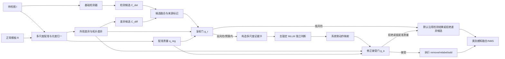

# 基于参考模板显式差异证据与双门控多模态大模型的 PCB 缺陷检测结果复核方法

> 建议方法名：**EviGate-PCB**（Evidence-Grounded and Dual-Gated PCB Verification）  
> 建议英文题目：**Reference-Guided Evidence Fusion and Dual-Gated Multimodal Verification for PCB Defect Detection**  
> 文献调研与方案版本：2026-07-11  
> 研究定位：硕士学位论文；以可验证、可复现、工作量可控为首要约束

---

## 0. 执行结论

原方案的总体方向是成立的：基础检测器负责高效定位，正常模板提供“该位置原本应当是什么”的反事实参照，显式差异模块突出细粒度变化，MLLM 负责局部证据推理，风险门控负责控制成本和误修正风险。

但按 2026 年已有研究重新审视后，论文不能再把以下内容单独表述为主要创新：

1. **使用正常模板进行 PCB 缺陷检测或复核**：Auto-VRS、ChangeChip、DeepPCB 系列方法和 RefDiffNet 已覆盖该思路；
2. **将参考图、差异图输入 MLLM 做工业异常判断**：UniPCB、DifferAD-R1、EMIT 等近期工作已涉及双图参考、差异引导或工业异常 MLLM；
3. **仅使用一个线性风险分数选择候选，再依据 MLLM 自报置信度修改检测结果**：该设计缺少校准目标，也没有充分处理 MLLM 作为验证器时的顺从/同意偏差与过度自信问题。

因此，建议把论文贡献重构为一个**风险受控的后置决策系统**，而不是“又一个参考图 + MLLM 模型”：

- 用**检测候选 + 差异候选**覆盖误报、错分类和漏检三类错误；
- 用**配准质量感知的外观—拓扑证据卡**把微小 PCB 差异转成 MLLM 可读证据；
- 让 MLLM 在**不查看基础检测类别和置信度**的情况下先独立判断，降低锚定与同意偏差；
- 设置两个不同目标的门控器：
  - **复核门**决定“是否值得调用 MLLM”；
  - **修正接受门**决定“MLLM 建议是否足够可靠，允许覆盖原结果”；
- 用**风险—覆盖率—调用成本**曲线和**有害修正率**评价系统，而不是只看最终 mAP。

### 最终建议的核心创新表述

1. **双来源候选的统一错误修复机制**：检测候选用于处理误报和错分类，模板差异候选用于恢复检测器没有提出框的漏检；MLLM 不直接自由定位，只验证已提出的候选假设。
2. **配准质量感知的外观—拓扑证据表示**：将像素/结构差异、骨架连通变化和局部拓扑统计组织为多尺度证据卡，并在模板失配时显式降级，避免错误差分驱动错误修正。
3. **去锚定 MLLM 与双门控保守决策**：MLLM 先独立给出缺陷存在性和类别判断，系统再依据外部视觉证据、配准质量和动作一致性决定是否接受修改，以较低调用率约束有害修正。

这三点形成明确闭环：**候选覆盖决定“能否修”，证据表示决定“能否看清”，双门控决定“是否该修以及是否敢修”。**

---

## 1. 对原方案的仔细审阅

### 1.1 原方案已有优势

原方案已经具备一篇应用型硕士论文所需的基本闭环：

- 问题边界明确：只做 PCB 表面缺陷检测结果复核，不训练通用大模型，不构建真实生产反馈闭环；
- 角色分工合理：检测器定位、模板提供参照、差异模块增强可见性、MLLM 做语义判断；
- 研究问题有层次：证据增益、实际纠错、调用效率与可靠性；
- 工作量可控：DeepPCB 主数据集、现成检测器、Prompt 复核、消融实验；
- 已考虑保守修改，避免 MLLM 无条件覆盖基础检测器。

这些内容应保留。

### 1.2 原方案必须补强的问题

| 问题 | 原方案中的表现 | 可能后果 | 本方案修正 |
|---|---|---|---|
| 配准质量未建模 | 默认测试图与模板可直接差分 | 1–2 像素偏移即可产生大面积伪差异 | 增加多尺度配准、光度归一和配准质量门 |
| 风险分数缺少学习目标 | `α(1-p)+βd+γq` 手工加权 | 权重难解释，跨数据集不稳定 | 用有监督、校准后的复核门预测“候选是否可被纠正” |
| MLLM 被基础结果锚定 | 输入初始类别和置信度 | MLLM 容易顺从既有答案，而非独立验证 | 默认隐藏类别/置信度，先生成独立证据判断 |
| 过度依赖 MLLM 自报置信度 | 以输出 confidence 作为接受依据 | 语言置信度不等于视觉正确率 | 使用外部证据驱动的修正接受门；自报置信度仅作弱特征或不使用 |
| 差异候选定义过粗 | 差分、阈值、连通域 | 大量噪声候选，漏检恢复收益可能被误报抵消 | 正常区域分位数阈值、形态过滤、来源标记、候选级接受门 |
| 结构差异仅骨架 XOR | 未考虑配准容差和拓扑语义 | 轻微位移会被误认为断路/短路 | 容差膨胀 XOR + 连通分量、端点、分叉点、Euler 数等拓扑向量 |
| 数据泄漏风险未彻底处理 | 仅提出按 PCB 对/模板划分 | 门控器可能学习到同一检测器训练样本的“过拟合错误” | 模板分组划分 + 检测器交叉拟合生成门控训练候选 |
| 评价过度集中于 mAP | 纠错行为评价不够细 | mAP 小幅变化掩盖大量有害修改 | 增加 FP 修正率、漏检恢复率、正确检测保留率、有害修正率、动作精度 |
| 创新边界受近期工作挤压 | “模板 + 差异 + MLLM”作为主要创新 | 容易被审稿/答辩质疑已有工作重叠 | 将创新定位为后置修正、去锚定验证、双门控与风险—成本评估 |

### 1.3 论文必须明确“不做”的内容

- 不让 MLLM 在整图上自由生成任意框；
- 不把自然语言解释当作主要性能指标；
- 不依赖真实生产操作员长期反馈；
- 不从头训练 MLLM；
- 不把 LoRA、GRPO、多智能体作为毕业必要条件；
- 不强行把无配对参考图的数据集包装成完整参考模板实验；
- 不以“首次使用模板”“首次使用差异图”“首次使用 MLLM 复核”为创新表述。

---

## 2. 相关研究与创新边界

### 2.1 PCB 检测、参考模板与结果复核

| 工作 | 核心做法 | 与本课题的关系 | 不能再声称的创新 |
|---|---|---|---|
| DeepPCB / Tang et al. | 输入正常模板与待检图，检测六类 PCB 缺陷；发布 1,500 对配准图像 | 主数据来源和参考图范式 | “首次利用正常模板检测 PCB 缺陷” |
| Huang–Wei PCB / HRIPCB | 10 个标准模板、1,386 张合成缺陷图，含旋转信息 | 配准鲁棒性与跨模板实验 | “仅在完全对齐图像上验证就足够” |
| Auto-VRS | AOI 后使用参考比较与深度网络做真/伪缺陷复核 | 说明后置缺陷验证已有历史 | “首次对 AOI/检测结果进行复核” |
| CSS-Net | 孪生网络区分真实缺陷与伪缺陷，关注代价敏感分类 | 与误报复核直接相关 | “二次分类本身就是创新” |
| ChangeChip | Golden PCB 与待检 PCB 的参考式无监督变化检测 | 差异候选与参考图基线 | “参考差异用于 PCB 是新思路” |
| RefDiffNet | 参考引导的残差、结构和形态处理，在检测前暴露微小缺陷 | 与显式差异证据高度接近 | “参考残差 + 结构线索本身是独立创新” |

### 2.2 工业异常检测与 MLLM

| 工作 | 核心结论 | 对本课题的启示 |
|---|---|---|
| AnomalyGPT | 通过工业异常数据和视觉解码器增强 LVLM 的异常检测与描述 | 通用 MLLM 对局部工业异常先验不足，需显式视觉专家或领域适配 |
| MMAD | 系统评估 MLLM 的工业异常识别、分类、定位、描述和分析能力 | MLLM 工业能力必须用细分任务量化，不能只展示案例 |
| Anomaly-OV | 用异常视觉 token 强化细粒度异常感知；指出通用 MLLM 对细微异常不敏感 | 不能把整图直接交给通用 MLLM；必须裁剪、放大、突出异常 |
| VMAD / EMIT | 通过视觉增强、参考对比、软提示或训练策略提升工业异常能力 | 差异证据应作为显式视觉输入，而不是只写在文字 Prompt 中 |
| UniPCB | PCB 视觉语言基准，含双图参考场景；一般 MLLM 仍存在细粒度定位与幻觉问题 | PCB+MLLM 已成为独立方向；本课题应强调后置修正和可靠性，而非基准构建 |
| DifferAD-R1 | 双图差异引导 MLLM 做工业异常定位，构建配对参考数据 | “参考图 + 差异引导 MLLM”已有直接先例；本课题的区分点是检测器后置纠错与双门控 |

### 2.3 选择性预测、校准和验证器可靠性

本课题本质上不仅是检测问题，也是一个**选择性决策（selective prediction）**问题：系统需要判断哪些样本由便宜模型自动处理，哪些交给昂贵模型，以及昂贵模型的修改是否可接受。

与此相关的理论和方法包括：

- SelectiveNet：以风险—覆盖率权衡形式学习拒识；
- 温度缩放：校准神经网络置信度；
- Learning to Defer：学习何时交给另一个专家；
- Conformal Risk Control：在校准集上控制选定动作的经验风险；
- MLLM Agreement Bias：MLLM 作为验证器时可能倾向于认可已有行为或答案；
- LLM/MLLM 自我修正研究：没有可靠外部反馈时，自我反思和自报置信度通常不足以形成稳定保证。

因此，本文的门控应依赖**任务特定的外部视觉信号**，而不是仅依赖检测置信度或 MLLM 的一句“我有 95% 信心”。

### 2.4 文献定位后的差异化矩阵

| 方法 | 配对正常参考 | 显式差异 | MLLM | 后置修正检测器 | 差异候选恢复漏检 | 配准质量门 | 去锚定验证 | 双门控 |
|---|---:|---:|---:|---:|---:|---:|---:|---:|
| DeepPCB 原始方法 | ✓ | 隐式 |  |  |  |  |  |  |
| Auto-VRS | ✓/比较 | ✓ |  | ✓ |  |  |  |  |
| ChangeChip | ✓ | ✓ |  |  | ✓/变化检测 | 部分 |  |  |
| RefDiffNet | ✓ | ✓ |  | 检测前增强 |  |  |  |  |
| UniPCB 双图任务 | ✓ | 可选 | ✓ |  |  |  |  |  |
| DifferAD-R1 | ✓ | ✓ | ✓ |  | 定位 |  |  |  |
| **EviGate-PCB** | ✓ | ✓，外观+拓扑 | ✓ | ✓ | ✓ | ✓ | ✓ | ✓ |

---

## 3. Motivation：为什么这个问题值得做

### 3.1 单图检测器的结构性局限

PCB 缺陷通常具有以下特征：

- 缺陷尺度小，可能仅占几十个像素；
- 正常线路重复、密集，局部纹理高度相似；
- open、short、spur、spurious copper 等类别的区别更依赖连通关系，而非普通物体语义；
- 光照、灰尘、轻微错位会制造与真实缺陷相似的像素差异；
- 检测器的高置信度不一定等于可靠，低置信度也不一定是错误。

继续堆叠 YOLO 模块、注意力模块或损失函数，容易进入“局部改网络、提升有限、解释不足”的同质化路线。

### 3.2 正常模板提供反事实信息

单图检测回答“这里像不像缺陷”；参考模板允许回答“这里与正常设计相比改变了什么”。

该信息尤其适合 PCB：

- **open**：本应连通的线断开；
- **short**：本应隔离的线被桥接；
- **mousebite**：边缘发生局部缺损；
- **spur**：出现细长多余分支；
- **pinhole/missing hole**：内部空洞或孔结构异常；
- **spurious copper**：出现额外铜区域或孤立铜块。

这些都是“相对正常结构的变化”，而不是仅靠对象外观可稳定识别的语义类别。

### 3.3 为什么需要 MLLM，但不能让其直接检测

MLLM 的价值在于：

- 能联合读取当前图、模板图、差异图、结构示意和缺陷定义；
- 能在封闭类别中执行条件推理；
- 能输出结构化判断和可审计的证据代码；
- 能处理传统阈值规则难以覆盖的组合模式。

MLLM 的风险在于：

- 对极小异常不敏感；
- 可能依赖文字先验而非视觉证据；
- 可能幻觉不存在的结构；
- 作为“裁判”时可能同意已有检测结论；
- 自报置信度不稳定；
- 全量调用成本和延迟高。

因此，MLLM 的最佳角色是**局部、选择性、受证据约束的独立验证器**。

### 3.4 核心研究矛盾

本研究需要同时优化三个目标：

1. **纠错收益**：删除误报、恢复漏检、修正类别；
2. **安全性**：不能因复核而大量删除原本正确的检测；
3. **成本**：不能对全部候选调用 MLLM。

这构成论文的核心优化问题：

\[
\max_{\pi}\; \mathbb{E}[\Delta U(\pi)]
- \lambda_c\,\mathbb{E}[N_{\text{call}}]
- \lambda_h\,\mathbb{E}[N_{\text{harm}}]
\]

其中，\(\pi\) 是复核与修正策略，\(\Delta U\) 是相对于基础检测器的效用增益，\(N_{\text{call}}\) 是 MLLM 调用数，\(N_{\text{harm}}\) 是有害修正数。

更适合实验呈现的约束形式为：

\[
\max \; F1_{\text{final}} \quad
\text{s.t.}\quad
\text{CallRate}\le B,\qquad
\text{HCR}\le \epsilon
\]

---

## 4. 核心 Insight

### Insight 1：复核对象应是“候选假设”，而不是整张图

MLLM 不擅长从高分辨率 PCB 整图中发现数像素缺陷，但可以验证一个已定位、放大并附带参照证据的局部假设。因此：

- 检测器提供语义候选；
- 差异模块提供检测器遗漏的变化候选；
- MLLM 只回答候选级问题，不自由生成新位置。

这将开放式视觉搜索问题转化为受控的候选验证问题。

### Insight 2：PCB 的关键证据不是单一差分强度，而是“外观变化 + 拓扑变化”

像素差异对灰尘、亮度和配准误差敏感；拓扑差异能表达断开、桥接、分叉和孔结构，但对分割误差敏感。两者互补：

- 外观证据回答“哪里发生了增减”；
- 拓扑证据回答“连通关系如何改变”；
- 配准质量回答“这些差异是否可信”。

### Insight 3：决定“是否调用”与决定“是否修改”是两个不同问题

一个候选可能值得让 MLLM 查看，但 MLLM 的结论仍不足以覆盖基础模型。因此必须拆分为：

- **Review Gate**：候选是否可能存在可修复错误；
- **Acceptance Gate**：MLLM 提议是否会带来净收益。

单门控无法同时优化调用成本和修改安全性。

### Insight 4：MLLM 应先独立判断，再与检测器结果比较

若直接告诉 MLLM“检测器认为这是 short，置信度 0.82”，模型容易围绕该结论构造理由。更可靠的流程是：

1. MLLM 只看视觉证据和类别定义；
2. 输出独立的缺陷存在性、类别和证据模式；
3. 系统在 MLLM 外部将独立判断与检测器结果比较并映射为 keep/remove/relabel/add；
4. 再由接受门决定是否执行。

### Insight 5：模板失败时，系统必须显式降级

错误配准产生的伪差异可能比真实缺陷更强。可靠系统不能假设模板永远可信：

- 配准质量低时，不允许自动 remove、relabel 或 add；
- 可回退到基础检测器，或标记为人工复核；
- 实验中必须单独评价该降级机制。

---

## 5. 研究问题与可检验假设

### RQ1：显式证据是否提升 MLLM 的候选级判断能力？

**变量**：当前区域、上下文、正常模板、外观差异、拓扑差异、数值拓扑摘要。  
**假设 H1**：完整证据卡在缺陷存在性 F1、类别 Macro-F1 和动作正确率上优于仅输入当前裁剪图。  
**关键控制**：使用完全相同的候选、MLLM、Prompt 骨架和解码参数。

### RQ2：双来源候选是否真正修复误报、漏检和错分类？

**变量**：仅检测候选、仅差异候选、二者联合。  
**假设 H2a**：检测候选复核显著降低 FP；  
**假设 H2b**：差异候选能恢复基础检测器未匹配的 GT；  
**假设 H2c**：联合方法在正确检测保留率不显著下降的前提下提高最终 F1/mAP。

### RQ3：双门控是否能在低调用率下保持大部分纠错收益？

**变量**：全量调用、随机门控、置信度门控、手工线性门控、学习式复核门、复核门+接受门。  
**假设 H3**：在相同调用预算下，学习式门控取得更高 F1 和更低有害修正率；接受门能显著提高动作精度和正确检测保留率。

### RQ4：系统对模板失配、光照变化和模型替换是否稳健？

**变量**：平移、旋转、亮度、模糊、噪声；检测器架构；MLLM 架构；数据集。  
**假设 H4**：配准质量门和容差拓扑差异能减缓性能退化；核心趋势不依赖单一检测器或单一 MLLM。

---

## 6. 任务定义

给定：

- 待检图像 \(I\)；
- 对应正常模板 \(R\)；
- 基础检测器 \(D\)；
- 封闭缺陷知识集合 \(K\)；
- MLLM 验证器 \(V\)。

基础检测器输出：

\[
C_{det}=\{(b_i,c_i,p_i)\}_{i=1}^{N_d}
\]

模板差异模块输出：

\[
C_{diff}=\{(b_j,s_j^{app},s_j^{topo})\}_{j=1}^{N_a}
\]

候选融合后：

\[
C=\operatorname{Fuse}(C_{det}\cup C_{diff})
\]

每个候选具有来源标记：

\[
s_i\in\{\text{DET},\text{DIFF},\text{BOTH}\}
\]

候选最终动作：

\[
a_i\in\{\text{keep},\text{remove},\text{relabel},\text{add},\text{reject},\text{defer}\}
\]

其中：

- `keep`：保留检测器框及类别；
- `remove`：删除检测器误报；
- `relabel`：位置保留，修改类别；
- `add`：接受一个差异模块已提出的框；
- `reject`：拒绝差异噪声候选；
- `defer`：证据或配准不可靠，不自动修改。

**重要约束**：MLLM 不允许自由生成不存在于 \(C\) 中的新框；`add` 只能接受 \(C_{diff}\) 中的候选。

---

## 7. EviGate-PCB 总体算法



### 7.1 阶段 A：模板配准与光度归一

#### 7.1.1 几何配准

建议采用“粗到细”的两级方案：

1. 使用数据集已有对齐关系、文件名或模板 ID 获取初始对应；
2. 在灰度图像金字塔上使用 ECC 优化仿射变换；
3. ECC 失败时，使用 ORB 特征 + RANSAC 单应性作为备选；
4. 将正常模板变换到待检图坐标：

\[
\hat T=\arg\max_T \operatorname{ECC}(I,W(R;T)),\qquad
R'=W(R;\hat T)
\]

DeepPCB 可将仿射自由度限制为平移或轻量仿射；HRIPCB 含旋转样本，应允许旋转和尺度微调。

#### 7.1.2 光度归一

对 \(I\) 和 \(R'\) 进行局部对比度归一或稳健线性亮度匹配：

\[
\tilde I=\frac{I-\operatorname{median}(I)}{\operatorname{MAD}(I)+\epsilon},\qquad
\tilde R=\frac{R'-\operatorname{median}(R')}{\operatorname{MAD}(R')+\epsilon}
\]

也可采用局部窗口归一，减少扫描光照与反射差异。

#### 7.1.3 配准质量分数

从下列低成本特征估计配准可靠性：

- ECC 相关系数；
- ORB/RANSAC 内点率；
- 边缘双向 Chamfer 距离；
- 去除最高残差区域后的背景中位差；
- 变换参数是否越界。

记配准特征为 \(z^{reg}\)，使用验证集或合成错位样本训练/校准：

\[
q_{reg}=g_{reg}(z^{reg})\in[0,1]
\]

当 \(q_{reg}<\tau_{reg}\) 时：

- 禁止基于模板的自动 `remove/relabel/add`；
- 可继续输出基础检测结果；
- 或将候选标记为 `defer`；
- 单独统计配准失败回退率。

### 7.2 阶段 B：基础检测器与置信度校准

基础检测器不是创新主体，建议：

- 主模型：课题组现有 YOLO 小型模型或 YOLOv8s/同等规模；
- 跨架构验证：RT-DETR-R18；
- 训练目标：稳定、高召回，而非刻意制造错误；
- 在验证集上使用温度缩放校准分类置信度：

\[
p_i^{cal}=\operatorname{softmax}(l_i/T)
\]

输出检测候选：

\[
C_{det}=\{(b_i,c_i,p_i^{cal},h_i)\}
\]

其中 \(h_i\) 可包含类别 margin、熵、TTA 方差等不确定性特征。

### 7.3 阶段 C：外观差异证据

#### 7.3.1 MVP 版本

\[
M_{pix}=\operatorname{Norm}(|\tilde I-\tilde R|)
\]

\[
M_{ssim}=\frac{1-\operatorname{SSIM}(\tilde I,\tilde R)}{2}
\]

\[
M_{app}=\eta_1M_{pix}+\eta_2M_{ssim}
\]

其中 \(\eta_1,\eta_2\) 只在验证集选择。

#### 7.3.2 可选增强

引入冻结的 DINOv2/轻量视觉编码器，得到 patch 特征差异：

\[
M_{feat}(x)=1-\cos(\phi(I)_x,\phi(R')_x)
\]

\[
M_{app}=\eta_1M_{pix}+\eta_2M_{ssim}+\eta_3M_{feat}
\]

该项作为扩展实验，不应成为最小可行版本的依赖。

### 7.4 阶段 D：拓扑差异证据

#### 7.4.1 铜线/结构二值化

对当前图和模板分别使用 Otsu、自适应阈值或模板引导阈值得到结构掩码：

\[
B_I=\operatorname{Segment}(\tilde I),\qquad
B_R=\operatorname{Segment}(\tilde R)
\]

形态学清理后骨架化：

\[
K_I=\operatorname{Skeleton}(B_I),\qquad
K_R=\operatorname{Skeleton}(B_R)
\]

#### 7.4.2 容差感知骨架 XOR

直接 XOR 对微小配准误差过敏，应加入半径 \(\delta\) 的容差：

\[
M_{topo}=
(K_I\land\neg\operatorname{Dilate}(K_R,\delta))
\lor
(K_R\land\neg\operatorname{Dilate}(K_I,\delta))
\]

#### 7.4.3 局部拓扑向量

对候选区域 \(b_i\) 计算：

\[
t_i=[
\Delta n_{cc},
\Delta n_{end},
\Delta n_{branch},
\Delta \chi,
\Delta L,
r_{xor},
\Delta A,
\Delta P
]
\]

含义：

- \(n_{cc}\)：连通分量数；
- \(n_{end}\)：骨架端点数；
- \(n_{branch}\)：分叉点数；
- \(\chi\)：Euler 数；
- \(L\)：骨架长度；
- \(r_{xor}\)：容差 XOR 占比；
- \(A\)：铜区域面积；
- \(P\)：轮廓周长。

#### 7.4.4 类别与拓扑模式的弱规则

| 类别 | 典型外观变化 | 典型拓扑变化 | 规则用途 |
|---|---|---|---|
| open | 局部铜缺失 | 连通分量/端点增加，出现断裂 | 接受门一致性特征，不作为硬分类器 |
| short | 多余桥接铜 | 连通分量减少或出现新连接 | 同上 |
| mousebite | 边缘凹口、材料缺失 | 主体连通通常不变，边界变化明显 | 同上 |
| spur | 细长突起 | 分叉点或支路长度增加 | 同上 |
| pinhole / missing hole | 内部小孔/孔缺失 | Euler 数与内部空洞变化 | 同上 |
| spurious copper | 额外铜岛或块 | 面积增加，可能新增连通分量 | 同上 |

规则只用于生成一致性特征，避免把传统规则本身伪装成最终分类器。

### 7.5 阶段 E：差异候选生成

先基于训练集非缺陷区域或伪正常对估计正常残差分布，再选择阈值：

\[
\tau_{app}=Q_{1-\alpha}(M_{app}\mid \text{normal region})
\]

二值异常区域：

\[
M_{bin}=\mathbf{1}[M_{app}>\tau_{app}]
\lor
\mathbf{1}[M_{topo}>\tau_{topo}]
\]

经过开闭运算、孔洞填充和连通域提取：

\[
C_{diff}=\operatorname{CCFilter}(M_{bin};A_{min},A_{max},\text{shape})
\]

每个差异候选保存：

- 外观残差均值、最大值、95% 分位数；
- 超阈值面积占比；
- 拓扑 XOR 面积；
- 局部拓扑向量；
- 与检测框的重叠；
- 配准质量。

### 7.6 阶段 F：候选融合

将 \(C_{det}\) 与 \(C_{diff}\) 构图聚类：

- IoU ≥ 0.3；或
- 一个框中心落入另一个扩张框；或
- 边界距离小于局部尺度阈值。

聚类后生成统一候选框并标记来源：

- `DET`：仅检测器支持；
- `DIFF`：仅差异模块支持；
- `BOTH`：二者共同支持。

建议保留原始框和融合框，避免融合框过大影响最终 mAP。MLLM 查看融合上下文，但最终 `keep/relabel` 默认沿用检测器原框；`add` 沿用差异框。可选扩展是使用差异掩码做确定性边界细化，但不列为主方法。

### 7.7 阶段 G：复核门 Review Gate

#### 7.7.1 目标定义

复核门不直接预测“是否有缺陷”，而预测“该候选是否存在值得 MLLM 介入的可修复错误”。

\[
y_i^{review}=1
\]

当且仅当：

- `DET/BOTH` 候选是误报；或
- `DET/BOTH` 候选位置匹配 GT，但类别错误；或
- `DIFF` 候选匹配了基础检测器未覆盖的 GT。

正确检测、差异噪声、无法通过当前动作集合修复的纯定位错误记为 0 或单独屏蔽。

#### 7.7.2 输入特征

\[
z_i^{review}=[
 p_i^{cal},\text{margin}_i,H_i,
 s_i,
 \operatorname{IoU}(C_{det},C_{diff}),
 \mu(M_{app}),Q_{95}(M_{app}),r_{app},
 t_i,q_{reg},
 \text{box size/aspect},
 \text{TTA disagreement}
]
\]

#### 7.7.3 模型选择

- 主模型：L2 正则 Logistic Regression，便于解释和校准；
- 对照：LightGBM/XGBoost；
- 输出：

\[
r_i=g_r(z_i^{review})=P(y_i^{review}=1\mid z_i^{review})
\]

调用策略：

- 阈值模式：\(r_i\ge\tau_r\)；
- 固定预算模式：每张图/全测试集选 Top-B 风险候选；
- 预算曲线：5%、10%、20%、40%、60%、100%。

### 7.8 阶段 H：多尺度证据卡

每个高风险候选生成一个固定布局的 2×3 证据卡：

| 面板 | 内容 | 目的 |
|---|---|---|
| P1 | 当前候选紧裁剪，放大 | 看细节 |
| P2 | 对应正常模板紧裁剪，放大 | 同位置对照 |
| P3 | 更大上下文，候选框叠加 | 防止过小裁剪丢失线路关系 |
| P4 | 外观差异热图/二值区域 | 突出材料增减 |
| P5 | 模板与当前骨架、容差 XOR | 突出断开、桥接、分叉 |
| P6 | 数值拓扑摘要与图例 | 给出稳定、可解析的结构证据 |

建议：

- 紧裁剪按框宽高扩张 1.5–2 倍；上下文按 3–4 倍；
- 最小输出分辨率 256×256，细小区域可 4 倍上采样；
- 当前图和模板保持完全相同坐标与缩放；
- 差异图使用固定色标和阈值，不随样本自动拉伸到误导性的强对比；
- 面板标题固定，避免 MLLM 混淆图像角色。

### 7.9 阶段 I：去锚定 MLLM 独立判断

#### 7.9.1 输入原则

默认**不提供**：

- 基础检测器预测类别；
- 基础检测器置信度；
- “检测器已经认为它是缺陷”之类的暗示；
- Ground Truth 或候选错误类型。

提供：

- 证据卡；
- 六类缺陷的简短、封闭定义；
- 当前参考是否可能不可靠的说明；
- 固定 JSON Schema。

#### 7.9.2 MLLM 推荐

- 主模型：Qwen3-VL-8B-Instruct；
- 稳定备选：Qwen2.5-VL-7B-Instruct；
- 跨模型鲁棒性：MiniCPM-V 4.5 8B；
- 毕业主线不要求 LoRA；若通用模型效果明显不足，再将 LoRA 作为扩展。

模型、权重版本、推理框架、量化方式、Prompt hash 必须冻结并记录。

#### 7.9.3 独立输出

MLLM 不直接输出“删除检测器框”，而只输出独立视觉判断：

```json
{
  "defect_present": true,
  "predicted_class": "open",
  "reference_reliability": "high",
  "appearance_pattern": ["missing_material"],
  "topology_pattern": ["disconnection", "more_endpoints"],
  "evidence_strength": 3,
  "reason_codes": ["A_MISSING", "T_BREAK"]
}
```

允许取值：

- `defect_present`: `true | false | null`；
- `predicted_class`: `open | short | mousebite | spur | pinhole | spurious_copper | normal | uncertain`；
- `reference_reliability`: `high | medium | low`；
- `evidence_strength`: 0–3；
- `reason_codes`: 固定枚举，不要求长篇自然语言推理。

主实验采用 greedy/temperature=0；另在 10% 子集进行多次采样稳定性分析。

### 7.10 阶段 J：系统侧动作映射

将 MLLM 的独立结论与候选来源、基础检测结果在模型外比较：

| 来源 | MLLM 独立结论 | 提议动作 |
|---|---|---|
| DET/BOTH | normal | remove |
| DET/BOTH | defect，类别与检测器相同 | keep |
| DET/BOTH | defect，类别不同且非 uncertain | relabel |
| DET/BOTH | uncertain | defer / keep |
| DIFF | defect | add |
| DIFF | normal | reject |
| DIFF | uncertain | reject / defer |

这一步消除“MLLM 已经知道检测器答案”的锚定路径。

### 7.11 阶段 K：修正接受门 Acceptance Gate

#### 7.11.1 目标定义

对于 MLLM 提议的动作 \(a_i\)，定义动作是否带来正效用：

\[
y_i^{accept}=
\mathbf{1}\left[
U(\hat Y\oplus a_i,Y^*)>U(\hat Y,Y^*)
\right]
\]

其中 \(\hat Y\) 是当前预测集合，\(Y^*\) 是训练/校准样本 GT，\(\oplus\) 表示执行候选动作。

候选级可操作定义：

- remove 正确：删除的是原始 FP；
- relabel 正确：位置已匹配 GT，新类别等于 GT；
- add 正确：差异候选匹配一个原本未匹配的 GT；
- keep 正确：原始检测确实正确；
- 其他会降低检测效用的修改为有害动作。

#### 7.11.2 输入特征

\[
z_i^{accept}=[
 z_i^{review},
 q_{reg},
 \text{MLLM class/presence},
 \text{evidence strength},
 \text{reference reliability},
 \text{topology compatibility},
 \text{appearance compatibility},
 \text{JSON validity},
 \text{optional token margin}
]
\]

注意：MLLM 自报的自由文本 confidence 不作为主要依据。

#### 7.11.3 接受策略

\[
a_i\text{ is applied}
\iff
q_{reg}\ge\tau_{reg}
\land
g_a(z_i^{accept})\ge\tau_a
\land\operatorname{SafetyRule}(a_i)
\]

安全规则：

- `remove` 阈值最高，默认保留正确检测；
- `relabel` 仅限封闭类别，且类别—拓扑一致性达到阈值；
- `add` 只接受已有差异候选，不允许 MLLM 自由造框；
- 配准不可靠时禁止参考驱动的破坏性动作；
- 无法解析 JSON 时回退默认结果；
- 多个候选冲突时优先保留检测器 TP 风险更低的方案。

可选扩展：在独立校准集上使用 conformal risk control 选择 \(\tau_a\)，目标是使经验有害修正率不超过 \(\epsilon\)。

### 7.12 阶段 L：最终融合

- 对保留/重分类/新增框执行类别感知 NMS 或 WBF；
- 保留动作来源、MLLM 输出、门控分数和是否回退的日志；
- 输出最终检测结果与审计记录。

---

## 8. 端到端伪代码

```python
for image_id, (test_img, ref_img) in dataset:
    # A. Registration and reference reliability
    ref_aligned, reg_features = register_multiscale(test_img, ref_img)
    test_norm, ref_norm = photometric_normalize(test_img, ref_aligned)
    q_reg = registration_gate(reg_features)

    # B. Base detector
    det_candidates = detector(test_img)
    det_candidates = calibrate_scores(det_candidates)

    # C-D. Explicit visual evidence
    app_map = appearance_difference(test_norm, ref_norm)
    topo_map, topo_graph = topology_difference(test_norm, ref_norm)

    # E. Difference-only proposals
    diff_candidates = propose_from_difference(app_map, topo_map)

    # F. Candidate fusion
    candidates = fuse_candidates(det_candidates, diff_candidates)
    final_actions = []

    for cand in candidates:
        review_features = extract_review_features(
            cand, det_candidates, diff_candidates,
            app_map, topo_map, topo_graph, q_reg
        )
        review_risk = review_gate(review_features)

        # Low-risk default path
        if review_risk < review_threshold:
            final_actions.append(default_action(cand))
            continue

        # G-H. Evidence-grounded, label-blind MLLM verification
        evidence_card = build_evidence_card(
            cand, test_norm, ref_norm, app_map, topo_map, topo_graph
        )
        mllm_result = verify_with_mllm(
            evidence_card=evidence_card,
            defect_knowledge=CLOSED_DEFECT_KNOWLEDGE,
            hide_detector_prediction=True
        )

        proposed_action = map_independent_judgment_to_action(
            candidate=cand,
            mllm_result=mllm_result
        )

        # K. External acceptance gate
        accept_features = extract_accept_features(
            review_features, mllm_result,
            proposed_action, q_reg, topo_graph
        )
        accept_prob = acceptance_gate(accept_features)

        if safety_check(proposed_action, q_reg, mllm_result) \
                and accept_prob >= accept_threshold:
            final_actions.append(proposed_action)
        else:
            final_actions.append(default_action(cand))

    predictions = apply_actions_and_nms(det_candidates, diff_candidates, final_actions)
    save_predictions_and_audit_log(image_id, predictions, final_actions)
```

---

## 9. 数据集选择与角色分工

### 9.1 建议的数据集组合

| 优先级 | 数据集 | 规模与标注 | 参考模板情况 | 在论文中的角色 |
|---|---|---|---|---|
| 必做 1 | **DeepPCB** | 1,500 对图像；六类缺陷；框标注 | 对齐的正常模板—待检图 | 主数据集；完整方法、RQ1–RQ3、主要消融 |
| 必做 2 | **Huang–Wei PCB / HRIPCB** | 1,386 张合成图；10 个标准模板；六类；含旋转 | 可按模板配对，且有姿态扰动 | 配准鲁棒性、跨模板/跨数据集验证 |
| 推荐 3 | **VisA 的 PCB1–PCB4** | VisA 共 10,821 图；四个 PCB 子集；像素级掩码 | 无一一配对正常模板，可从训练正常集检索 | 无精确配对条件下的外部异常验证；二分类/分割候选验证 |
| 可选 4A | **DsPCBSD+** | 10,259 图、20,276 个框、九类缺陷 | 无可靠一一配对模板 | 检测器预训练、类别扩展、无模板分支外部验证 |
| 可选 4B | **PCB-IND** | 4,789 图、5,932 实例、八类真实 AOI 缺陷 | 工业实拍，通常不提供配对正常模板 | 真实域迁移、长尾和复杂光照外部验证 |

### 9.2 为什么不是所有数据集都跑完整方法

完整方法要求同位置正常参考。对没有严格配对模板的数据集，不能人为假设一个任意正常图就是精确模板，否则差异图会同时包含产品几何变化、拍摄变化和真实缺陷。

因此：

- DeepPCB、HRIPCB：运行完整 EviGate-PCB；
- VisA PCB：只从训练正常样本中检索最近邻参考，评价二分类异常判断和候选验证，并明确这是“检索参考”设置；
- DsPCBSD+/PCB-IND：用于基础检测器预训练、无模板对照或域迁移，不把它们写成完整配对模板结果。

### 9.3 类别本体对齐

不同数据集缺陷名并不完全一致：

- DeepPCB：open、short、mousebite、spur、pinhole、spurious copper；
- HRIPCB：常见版本使用 missing hole、mouse bite、open circuit、short、spur、spurious copper；
- DsPCBSD+：含 open、short、mouse bite、spur、spurious copper，以及 hole breakout、scratch、foreign object 等。

跨数据集比较应采用：

1. 二分类：defect vs normal；
2. 五个直接共享类别子集；
3. 将 pinhole、missing hole、hole breakout 分开报告，除非有明确、人工审核的映射规则。

### 9.4 数据划分与防泄漏规则

#### DeepPCB

同时报告两种协议：

1. **官方/常用划分**：便于与既有论文比较；从训练部分再划验证集；
2. **严格模板分组划分**：按模板 ID、原始大图 ID 或文件前缀 Group Split，建议 60/20/20。

主结论优先基于严格分组划分，官方划分作为可比性补充。

#### HRIPCB

按 10 个标准模板分组，不允许同一模板的旋转/衍生图同时进入训练和测试。建议 5-fold GroupKFold；计算量不足时使用固定 6/2/2 模板划分并公开模板 ID。

#### VisA PCB

遵循官方 one-class 划分；参考图只能从训练正常图中检索，不能从测试图或测试异常图中选择。

#### 门控训练的特殊防泄漏

复核门和接受门不能直接用“检测器在其自身训练图上的预测”训练。推荐交叉拟合：

1. 将检测器训练集分成 K 折；
2. 每次用 K-1 折训练检测器，在剩余一折产生预测；
3. 合并全部 out-of-fold 预测，构造门控训练候选；
4. 在独立验证集选择阈值和 Prompt；
5. 测试集只运行一次最终配置。

### 9.5 候选级诊断集与自然分布测试集

需要区分两类评价集：

- **自然分布端到端测试集**：不重采样，用于最终 Precision/Recall/F1/mAP；
- **候选级诊断集**：从测试/验证候选中按 TP、FP、错分类、真实差异漏检候选、差异噪声分层采样，用于 RQ1 的证据消融。

诊断集可以平衡错误类型，但不能用其比例推断真实部署性能。

---

## 10. 完整实验设计

## 10.1 基础配置

- 基础检测器：主模型 1 个；跨架构模型 1 个；
- MLLM：主模型 1 个；第二模型只做关键消融或 20% 子集复验；
- 主数据：DeepPCB；
- 配准外部验证：HRIPCB；
- 无精确模板外部验证：VisA PCB1–PCB4；
- 主方法不进行 MLLM 微调；
- 所有阈值只在验证/校准集确定；
- MLLM 输出缓存，保证重复实验成本可控。

### 10.2 基线与方法编号

| 编号 | 方法 | 目的 |
|---|---|---|
| B0 | 基础检测器 | 原始性能 |
| B1 | 基础检测器 + 验证集最优置信度阈值 | 排除简单调阈值收益 |
| B2 | ECC + SSIM/绝对差分 + 形态学候选 | 传统参考差异基线 |
| B3 | 检测器 + 全量 MLLM，仅当前紧裁剪 | 验证直接 MLLM 复核是否有效 |
| B4 | B3 + 正常模板裁剪 | 验证参考图价值 |
| B5 | B4 + 外观差异图 | 验证外观显式证据 |
| B6 | B5 + 拓扑图/拓扑向量 | 验证结构证据 |
| B7 | B6 + 双来源候选，全量 MLLM | 验证漏检恢复上限，不考虑成本 |
| B8 | B7 + 原方案手工线性风险门 | 与原设计直接比较 |
| B9 | B7 + 学习式复核门 | 验证调用选择收益 |
| B10 | B9 + 去锚定 MLLM | 验证隐藏检测结果是否降低偏差 |
| **Full** | B10 + 配准质量门 + 修正接受门 + 保守规则 | 完整 EviGate-PCB |

可选直接相关基线：

- ChangeChip 或其公开实现；
- RefDiffNet 风格的参考增强检测器；
- CSS-Net 风格的候选二次分类器；
- 若代码和数据协议兼容，可加入 DifferAD-R1 的双图 MLLM 结果作为参考，但不应把复现该大模型训练作为毕业必要条件。

### 10.3 Oracle 上界

仅报告方法结果不足以定位瓶颈，需加入上界：

1. **Candidate Oracle**：在固定候选集合中，用 GT 选择正确 keep/remove/relabel/add；反映候选生成上限；
2. **Review Oracle**：只调用所有可修复错误候选；反映最佳门控调用率；
3. **Acceptance Oracle**：给定真实 MLLM 输出，仅接受其中能改善结果的动作；反映接受门上限。

若 Candidate Oracle 提升很小，问题在候选召回；若 Candidate Oracle 高但 Full 低，问题在 MLLM/接受门；若全量 MLLM 高但门控低，问题在复核门。

---

## 11. RQ1：证据增益实验

### 11.1 固定条件

- 固定同一候选诊断集；
- 固定主 MLLM、模型权重、解码方式；
- Prompt 只改变实际提供的证据，不改任务措辞；
- 不向 MLLM 提供基础检测标签和置信度；
- 每个候选只评估独立判断，不受最终门控影响。

### 11.2 证据消融

| 编号 | 当前紧裁剪 | 上下文 | 正常模板 | 外观差异 | 拓扑图 | 数值拓扑 | 目的 |
|---|---:|---:|---:|---:|---:|---:|---|
| A0 | ✓ |  |  |  |  |  | 最弱输入 |
| A1 | ✓ | ✓ |  |  |  |  | 验证上下文 |
| A2 | ✓ | ✓ | ✓ |  |  |  | 验证正常模板 |
| A3 | ✓ | ✓ | ✓ | ✓ |  |  | 验证外观证据 |
| A4 | ✓ | ✓ | ✓ |  | ✓ |  | 单独验证拓扑图 |
| A5 | ✓ | ✓ | ✓ | ✓ | ✓ |  | 图像式完整证据 |
| A6 | ✓ | ✓ | ✓ | ✓ | ✓ | ✓ | 完整证据卡 |

附加消融：

- A6-label-aware：向 MLLM 提供检测类别和置信度；
- A6-label-blind：隐藏检测信息；
- A6-no-reg-warning：不提示参考可能不可靠；
- A6-free-text：自由文本输出；
- A6-JSON：固定 JSON 输出。

### 11.3 RQ1 指标

- 缺陷存在性 Accuracy、Precision、Recall、F1；
- 六类 Macro-F1、每类 F1；
- 独立动作映射准确率；
- normal/defect 混淆矩阵；
- `uncertain` 比例；
- JSON 可解析率；
- 按缺陷尺寸、配准质量、候选来源分层结果；
- 100–200 个样本的人工证据一致性审计，作为补充而非主指标。

### 11.4 预期重点案例

- open vs short：连通性相反；
- mousebite vs spur：材料缺失与材料增加；
- spur vs spurious copper：细长分支与块状/孤立铜；
- 小 pinhole：当前图单看不明显，但模板与 Euler/空洞变化明确；
- 灰尘/反光：像素差异强但拓扑差异弱；
- 错位：外观和骨架差异广泛，但配准质量低。

---

## 12. RQ2：端到端检测纠错实验

### 12.1 基础检测错误分解

在 IoU ≥ 0.5 下，将基础检测输出分为：

- 正确 TP：位置和类别均正确；
- 错分类：位置匹配 GT，但类别错误；
- FP：未匹配任何 GT；
- FN：GT 未被任何正确类别预测匹配；
- 纯定位错误：与 GT 有重叠但 IoU 不达阈值，当前主方法不保证可修复。

必须在实验报告中先给出错误分布，否则无法判断可纠错空间。

### 12.2 双来源候选验证

依次比较：

1. 仅 \(C_{det}\)；
2. 仅 \(C_{diff}\)；
3. \(C_{det}\cup C_{diff}\)；
4. 联合候选 + MLLM；
5. 完整双门控。

同时报告：

- 差异候选对基础 FN 的候选召回率（IoU 0.3 与 0.5）；
- 每个真实漏检平均产生的差异候选数；
- 每图差异噪声候选数；
- `BOTH` 候选的错误率是否显著低于单来源候选。

### 12.3 端到端指标

- Precision、Recall、F1；
- mAP@0.5、mAP@0.5:0.95；
- 每类 AP/F1；
- FP 修正率、漏检恢复率、类别修正准确率；
- 正确检测保留率；
- 有害修正率；
- 动作精度与动作召回率；
- 错误转移矩阵：原始错误类型 → 最终状态。

### 12.4 必须报告的负面结果

- 被错误删除的 TP 数；
- 被错误重分类的正确框数；
- 差异候选造成的新增 FP 数；
- MLLM 将错误类别改成另一个错误类别的数量；
- 低配准质量样本中，质量门拦截了多少有害动作；
- 无法被当前动作集合修复的定位错误比例。

---

## 13. RQ3：效率、门控与可靠性实验

### 13.1 门控对照

在相同调用预算下比较：

1. 全量调用；
2. 随机选择；
3. 按检测器低置信度选择；
4. 原方案手工线性分数；
5. Logistic 复核门；
6. LightGBM 复核门；
7. 复核门 + 接受门；
8. 可选：复核门 + conformal 风险阈值。

### 13.2 调用预算

建议固定预算点：

\[
B\in\{5\%,10\%,20\%,40\%,60\%,100\%\}
\]

每个预算点报告：

- 最终 F1/mAP；
- 错误候选复核召回率；
- 有害修正率；
- 正确检测保留率；
- MLLM 调用次数/图；
- 平均、P50、P95 延迟；
- 输入图像 token/文本 token；
- 实际或估算成本。

### 13.3 关键曲线

- F1/mAP — Call Rate；
- Harmful Correction Rate — Call Rate；
- Action Precision — Coverage；
- Risk — Coverage；
- 复核门 PR/ROC；
- 接受门校准曲线、ECE、Brier Score；
- 单位调用带来的净 TP 增益。

### 13.4 去锚定验证实验

比较：

- MLLM 看到检测标签与置信度；
- 只看到检测标签，不看置信度；
- 完全隐藏检测结果；
- 两阶段：先独立判断，再在第二阶段提供检测结果。

主方案优先使用“完全隐藏”，因为只需一次 MLLM 调用；两阶段方法作为成本更高的对照。

重点统计：

- 对错误检测标签的顺从率；
- 对正确检测标签的保留率；
- 删除 FP 与误删 TP 的平衡；
- 错误标签被 MLLM 重述/合理化的比例。

---

## 14. RQ4：鲁棒性与泛化实验

### 14.1 人工配准扰动

对测试模板施加：

- 平移：±1、±2、±4、±8 px；
- 旋转：±0.5°、±1°、±2°；
- 尺度：0.98、1.02；
- 轻微透视扰动（可选）。

比较：

- 无二次配准；
- ECC 配准；
- ECC + 配准质量门；
- 直接骨架 XOR vs 容差 XOR。

### 14.2 光度与成像扰动

- 亮度 ±10%、±20%；
- 对比度 0.8、1.2；
- 高斯噪声标准差 2/255、5/255；
- 高斯模糊 σ=0.5、1.0；
- 局部高光/阴影模拟。

### 14.3 模型替换

- YOLO 系主检测器 → RT-DETR-R18；
- Qwen3-VL-8B → MiniCPM-V 4.5 8B 或 Qwen2.5-VL-7B；
- Logistic gate → LightGBM gate。

若主要结论只在单一模型上成立，应在论文中明确限制，不能泛化表述。

### 14.4 跨数据集

- DeepPCB 训练/开发，HRIPCB 测试：评价配准和共享类别；
- DeepPCB 规则/Prompt 固定，VisA PCB 测试：评价缺陷存在性，不报告六类 mAP；
- 可选：DsPCBSD+ 或 PCB-IND 预训练检测器后，再在 DeepPCB/HRIPCB 微调，评价数据规模与真实域先验是否有帮助。

---

## 15. 指标定义

设基础检测器输出中的 FP、FN、错分类和正确 TP 数分别为 \(N_{FP}^0,N_{FN}^0,N_{MC}^0,N_{TP}^0\)。

### 15.1 常规检测指标

- Precision；
- Recall；
- F1；
- mAP@0.5；
- mAP@0.5:0.95。

### 15.2 纠错指标

#### 误报修正率 FPCR

\[
\mathrm{FPCR}=\frac{\text{正确删除的基础 FP}}{N_{FP}^0}
\]

#### 漏检恢复率 MDRR

\[
\mathrm{MDRR}=\frac{\text{复核后新增匹配的原始 FN}}{N_{FN}^0}
\]

#### 类别修正准确率 MCCA

\[
\mathrm{MCCA}=\frac{\text{正确重分类的基础错分类框}}{N_{MC}^0}
\]

#### 正确检测保留率 TPRR

\[
\mathrm{TPRR}=\frac{\text{复核后仍正确的基础 TP}}{N_{TP}^0}
\]

建议目标：TPRR 必须优先保持在较高水平；具体阈值由验证集与应用风险共同确定，不应事后挑选。

### 15.3 动作质量指标

#### 动作精度 AP\(_{action}\)

\[
\mathrm{AP}_{action}=\frac{\text{带来正效用的已接受修改}}{\text{全部已接受修改}}
\]

#### 动作召回 AR\(_{action}\)

\[
\mathrm{AR}_{action}=\frac{\text{带来正效用的已接受修改}}{\text{候选集合中全部可实现的正效用修改}}
\]

#### 有害修正率 HCR

\[
\mathrm{HCR}=\frac{\text{降低检测效用的已接受修改}}{\text{全部已接受修改}}
\]

同时报告“每个原始 TP 的有害修正数”，防止修改数量很少时比例不稳定。

### 15.4 门控与成本指标

- MLLM Call Rate；
- Calls per Image；
- Review Recall：可修复错误中被送入 MLLM 的比例；
- Gate ECE、Brier Score；
- AURC（Area Under Risk-Coverage Curve）；
- 平均/P95 推理时延；
- GPU 显存、吞吐量；
- Token 数与单位图像成本；
- 配准失败率和回退率。

---

## 16. 统计检验与实验可信度

### 16.1 重复与随机性

- 基础检测器使用 3 个随机种子；
- MLLM 主实验采用确定性解码；
- 在 10% 分层子集上进行 3 次随机解码，评价输出稳定性；
- 所有 MLLM 响应缓存，避免重复调用造成版本漂移。

### 16.2 置信区间

- 以图像为聚类单位进行 10,000 次 paired bootstrap；
- 报告指标差值及 95% CI；
- 候选级结果也应按图像聚类抽样，避免把同一图中的多个候选当作独立样本。

### 16.3 显著性

- 对成对二分类结果可报告 McNemar 检验作为补充；
- 对 AP/F1 差异使用 paired bootstrap/permutation；
- 多组消融使用 Holm–Bonferroni 校正；
- 除 p 值外报告效应量和置信区间。

### 16.4 Prompt 与阈值冻结

- Prompt 只在开发/验证集修改；
- 选择最终 Prompt 后生成 hash；
- 测试集不得再依据失败案例修改 Prompt、类别定义或阈值；
- 若确需修改，原测试集必须降为开发集并重新建立测试集。

---

## 17. DeepPCB 可能“过于容易”的处理

DeepPCB 在常规划分上可能被现代检测器接近饱和，导致可纠错错误太少。处理方式应是提高评价严格性，而不是故意破坏检测器：

1. 使用模板/原图分组划分，降低近重复泄漏；
2. 报告不同缺陷尺寸分层；
3. 增加合成配准、光照和模糊压力测试；
4. 加入 HRIPCB 跨模板与跨数据集测试；
5. 使用小/中型检测器保证工程可复现，但不能刻意降低训练质量；
6. 同时报告自然分布结果和压力测试结果；
7. 用 Oracle 结果说明真实可纠错空间。

若最终 mAP 提升有限，但在较低调用率下显著减少误报、保持高 TPRR、降低有害修正，并在严格划分/扰动下表现稳定，仍可形成有说服力的硕士论文。

---

## 18. 实现细节建议

### 18.1 推荐默认超参数范围

| 模块 | 默认/搜索范围 | 选择原则 |
|---|---|---|
| ECC 金字塔 | 3 层 | 兼顾轻微旋转和平移 |
| ECC 迭代 | 50–200 | 验证集收敛与延迟权衡 |
| 骨架容差 \(\delta\) | 1–3 px | 以正常区域伪差异最低为准 |
| 差异阈值 | 正常残差 99%–99.9% 分位 | 不使用测试 GT 调参 |
| 候选最小面积 | 依图像分辨率搜索 5–30 px | 保留 pinhole 等微小缺陷 |
| 候选融合 IoU | 0.2–0.4 | 以候选召回和重复率权衡 |
| 紧裁剪扩张 | 1.5–2.0× | 保留局部边界 |
| 上下文扩张 | 3–4× | 保留连通关系 |
| MLLM 解码 | temperature=0，短 JSON | 稳定、低成本 |
| Review Gate | Logistic + L2 | 主结果可解释 |
| Acceptance Gate | Logistic/LightGBM | 以动作精度和校准为主 |

所有最终值必须由验证集确定并在附录公开。

### 18.2 代码模块划分

```text
project/
├── configs/
│   ├── detector/
│   ├── evidence/
│   ├── gates/
│   └── mllm/
├── data/
│   ├── manifests/
│   ├── splits/
│   └── class_maps/
├── src/
│   ├── registration/
│   ├── detector/
│   ├── evidence/
│   ├── candidates/
│   ├── gates/
│   ├── mllm/
│   ├── decision/
│   └── evaluation/
├── cache/
│   ├── detector_predictions/
│   ├── evidence_cards/
│   └── mllm_outputs/
├── experiments/
│   ├── rq1_evidence/
│   ├── rq2_correction/
│   ├── rq3_gating/
│   └── rq4_robustness/
└── reports/
```

### 18.3 审计记录

每个候选保存一条 JSONL：

```json
{
  "image_id": "...",
  "candidate_id": "...",
  "source": "BOTH",
  "det_box": [0, 0, 0, 0],
  "diff_box": [0, 0, 0, 0],
  "det_class": "short",
  "det_score_cal": 0.63,
  "q_reg": 0.91,
  "review_score": 0.78,
  "mllm_output": {},
  "proposed_action": "relabel",
  "accept_score": 0.87,
  "final_action": "relabel",
  "gt_match_before": {},
  "gt_match_after": {}
}
```

这将显著降低后期消融和错误分析成本。

---

## 19. 最小可行版本与扩展版本

### 19.1 MVP：必须完成

1. DeepPCB 严格数据划分和基础检测器；
2. ECC 配准、光度归一和配准质量分数；
3. 绝对差分 + SSIM 外观证据；
4. 二值结构、骨架、容差 XOR 和基础拓扑向量；
5. 双来源候选与候选级数据记录；
6. 一个开源 7B/8B MLLM 的去锚定 JSON 复核；
7. Logistic 复核门与 Logistic/LightGBM 接受门；
8. RQ1、RQ2、RQ3 完整实验；
9. HRIPCB 的配准/外部验证；
10. 统计检验和错误案例分析。

### 19.2 推荐增强

- VisA PCB1–PCB4 检索参考实验；
- 第二检测器、第二 MLLM 的子集鲁棒性；
- DINOv2 特征差异；
- conformal 风险阈值；
- 简单 Web Demo；
- 100–200 例人工证据审计。

### 19.3 不建议作为毕业主线

- 全参数微调 MLLM；
- 大规模 GRPO；
- 多智能体协作；
- 在线持续学习；
- 真实生产反馈闭环；
- 同时复现大量最新 MLLM 异常检测模型。

---

## 20. 16 周实验规划

| 周次 | 工作 | 完成标志 |
|---|---|---|
| 1–2 | 数据集下载、许可核查、模板 ID 审计、严格划分 | 数据 manifest、split 文件、泄漏检查报告 |
| 3–4 | 训练基础检测器、置信度校准、错误分解 | B0/B1 结果与 FP/FN/错分类清单 |
| 5 | ECC/ORB 配准与光度归一 | 配准可视化、质量指标、失败样本 |
| 6 | 外观差异、拓扑差异和差异候选 | 候选召回/噪声统计 |
| 7 | 候选融合、out-of-fold 候选生成 | 门控训练表格数据 |
| 8 | 证据卡生成与 Prompt/JSON 原型 | 解析率稳定，缓存机制完成 |
| 9 | RQ1 证据消融 | A0–A6 候选级结果 |
| 10 | 复核门、接受门训练与校准 | Gate ROC/PR、校准曲线 |
| 11–12 | RQ2 端到端纠错、Oracle 分析 | B0–Full、错误转移矩阵 |
| 13 | RQ3 调用预算和成本曲线 | F1–调用率、HCR–调用率 |
| 14 | RQ4 配准扰动、HRIPCB/外部验证 | 鲁棒性曲线 |
| 15 | 统计检验、可视化、人工案例审计 | 置信区间、案例图、表格定稿 |
| 16 | 论文方法章/实验章整理 | 可复现包、论文初稿 |

若时间压缩，优先保证 DeepPCB + HRIPCB、一个检测器、一个 MLLM、双门控和 RQ1–RQ3；VisA、第二模型和特征差异可删减。

---

## 21. 失败模式与备选方案

| 风险 | 诊断信号 | 主处理 | 备选降级 |
|---|---|---|---|
| MLLM 看不清微小缺陷 | A0–A6 均低；小缺陷召回低 | 多尺度裁剪、固定放大、差异图、拓扑向量 | 先只做 defect/normal 二分类，不做六类重分类 |
| 模板错位产生伪差异 | 差异区域遍布线路；q_reg 低 | 多尺度 ECC、容差 XOR、质量门 | 低 q_reg 时完全回退检测器 |
| 差异候选过多 | 每图候选数暴涨、DIFF precision 极低 | 正常分位阈值、面积/形状过滤、复核门 | 仅将 Top-K 差异候选送入门控 |
| MLLM 误删 TP | TPRR 明显下降 | 去锚定、remove 高阈值、接受门 | 禁止自动 remove，仅输出复核标记 |
| 重分类不稳定 | 类别混淆矩阵恶化 | 类别—拓扑一致性、分类专用阈值 | 只允许 keep/remove/add，不允许 relabel |
| MLLM 输出格式不稳 | JSON 解析失败 | Schema、枚举、短输出、重试一次 | 解析失败默认不修改 |
| 调用成本过高 | 全量实验无法完成 | Review Gate、缓存、开源 8B、固定预算 | 只在诊断集和高风险候选调用 |
| DeepPCB 提升空间小 | B0 已接近饱和 | 严格分组、压力测试、HRIPCB | 论文重点转向风险—成本、HCR、TPRR |
| 门控过拟合 | 验证好、测试差 | OOF 预测、简单模型、校准 | 退回手工规则并诚实报告限制 |
| 最新工作创新重叠 | 答辩质疑“参考图+MLLM 已有” | 强调后置动作闭环、去锚定和双门控 | 缩小题目，不宣称通用 MLLM 创新 |

---

## 22. 预期图表

### 22.1 论文主图

1. 整体 EviGate-PCB 流程图；
2. 2×3 证据卡示意；
3. 双门控决策时序图；
4. 基础错误到最终状态的 Sankey/转移图；
5. F1/mAP—调用率曲线；
6. HCR—调用率曲线；
7. 配准扰动—性能曲线；
8. 每类证据增益柱状图；
9. 典型成功/失败案例。

### 22.2 论文主表

1. 相关工作定位表；
2. 数据集与划分表；
3. RQ1 证据消融；
4. RQ2 端到端基线；
5. FPCR/MDRR/MCCA/TPRR/HCR；
6. RQ3 门控预算；
7. RQ4 鲁棒性与跨模型；
8. 计算开销和成本；
9. Oracle 上界与瓶颈分解。

---

## 23. 可直接使用的 MLLM Prompt 草案

### System Prompt

```text
You are an evidence-grounded verifier for localized PCB surface-defect candidates.
Judge only the supplied visual evidence. Do not assume that an upstream detector is correct.
The normal-reference crop represents the expected structure only when the reference is reliable.
Inspect the current crop, normal reference, appearance-difference map, topology-difference map,
and the numeric topology summary.
Choose only from the closed label set.
If evidence is insufficient or the reference appears misaligned, return uncertain.
Return one valid JSON object matching the schema. Do not return markdown or additional prose.
```

### Closed Defect Knowledge

```text
open: an intended conductor is locally disconnected or broken.
short: two intendedly separate conductors are connected by an unintended bridge.
mousebite: a localized notch or missing material appears along a conductor/board edge.
spur: a narrow unintended protruding branch extends from a conductor.
pinhole: a small unintended internal hole/void appears in a copper region.
spurious_copper: an unintended copper island or extra copper region is present.
normal: no supported defect is visible at the candidate location.
```

### User Prompt

```text
The evidence card contains:
P1 current candidate crop;
P2 aligned normal-reference crop;
P3 larger current context with candidate box;
P4 appearance-difference evidence;
P5 topology/skeleton-difference evidence;
P6 numeric topology summary and legend.

Determine independently:
1. whether a supported defect is present;
2. the most likely class;
3. whether the reference is reliable;
4. which fixed appearance and topology patterns are supported.

Return the required JSON only.
```

### JSON Schema

```json
{
  "defect_present": "true|false|null",
  "predicted_class": "open|short|mousebite|spur|pinhole|spurious_copper|normal|uncertain",
  "reference_reliability": "high|medium|low",
  "appearance_pattern": [
    "missing_material|extra_material|edge_notch|internal_void|none|uncertain"
  ],
  "topology_pattern": [
    "disconnection|new_connection|extra_branch|more_endpoints|new_component|hole_change|none|uncertain"
  ],
  "evidence_strength": "0|1|2|3",
  "reason_codes": [
    "A_MISSING|A_EXTRA|A_NOTCH|A_VOID|T_BREAK|T_BRIDGE|T_BRANCH|T_COMPONENT|T_HOLE|REF_BAD|NO_SUPPORT"
  ]
}
```

---

## 24. 论文贡献写法

建议在论文中写成以下三点，不使用“首次”措辞：

1. **提出一种面向 PCB 检测结果复核的双来源候选框架。** 该框架联合检测器语义候选和正常模板差异候选，在统一候选空间中分别处理误报、错分类和基础检测器未提出候选的漏检问题。
2. **设计一种配准质量感知的外观—拓扑证据表示。** 通过多尺度当前/模板裁剪、外观残差、容差骨架差异及局部拓扑统计，将细粒度材料与连通变化组织为可供 MLLM 验证的结构化证据，并在参考失配时触发安全降级。
3. **构建去锚定的 MLLM 双门控保守修正机制。** MLLM 在隐藏基础检测标签的条件下独立判断，学习式复核门控制调用预算，外部证据驱动的接受门约束修改动作，从而在风险—覆盖率—成本框架下减少有害修正。

---

## 25. 推荐题目、摘要和论文结构

### 25.1 推荐中文题目

**基于参考模板显式差异证据与双门控多模态大模型的 PCB 缺陷检测结果复核方法**

较稳妥的简化题目：

- 基于多模态证据与风险门控的 PCB 缺陷检测结果复核方法；
- 基于正常模板和双门控多模态大模型的 PCB 缺陷复核研究；
- 面向 PCB 缺陷检测的参考证据引导选择性复核方法。

### 25.2 推荐英文题目

**Reference-Guided Evidence Fusion and Dual-Gated Multimodal Verification for PCB Defect Detection**

### 25.3 摘要草案

> 针对 PCB 表面缺陷检测器在细粒度线路变化、正常纹理扰动和相似缺陷类别下容易出现误报、漏检与错分类的问题，本文提出一种基于参考模板显式差异证据与双门控多模态大模型的检测结果复核方法 EviGate-PCB。该方法首先对待检图与正常模板进行几何配准和光度归一，联合基础检测器候选与模板差异候选构建统一候选集合，使系统既能复核已有检测结果，也能验证潜在漏检区域。针对 PCB 缺陷对材料变化和线路连通关系高度敏感的特点，方法构造外观残差、容差骨架差异及局部拓扑统计，并将其组织为多尺度证据卡。为降低基础检测标签对多模态大模型判断的锚定影响，验证器在不接收检测类别与置信度的条件下独立输出缺陷存在性、类别及证据模式，随后由系统侧映射为保留、删除、重分类或新增动作。进一步地，学习式复核门选择值得调用大模型的高风险候选，外部证据驱动的修正接受门判断大模型建议是否足以覆盖原结果；当模板配准不可靠或证据不足时，系统采用保守回退策略。实验在 DeepPCB、HRIPCB 及 VisA PCB 子集上从证据增益、误报/漏检/错分类修正、风险—覆盖率—调用成本以及配准鲁棒性等方面进行评价。预期结果表明，该方法能够在保持较高正确检测保留率和较低大模型调用率的同时，提高检测结果的可靠性，并减少由大模型误判引起的有害修正。

### 25.4 论文章节结构

1. 绪论：背景、问题、动机、研究内容与贡献；
2. 相关工作：PCB 检测、参考模板/变化检测、工业异常 MLLM、选择性预测与校准；
3. 问题定义与总体框架；
4. 配准质量感知的双来源候选与外观—拓扑证据；
5. 去锚定 MLLM 双门控复核与保守修正；
6. 实验设计、结果与分析；
7. 总结与展望。

---

## 26. Go/No-Go 判断标准

### 26.1 继续完整课题的最低先导结果

在约 10%–20% 开发子集上，满足以下至少三项：

- 加入模板和显式差异后，MLLM 候选存在性 F1 明显高于仅当前裁剪；
- 差异候选对基础 FN 有可用召回，且平均噪声候选数可被门控压缩；
- 去锚定设置减少对错误检测标签的顺从；
- 接受门相对无门控显著降低 HCR；
- 在 20%–40% 调用率下保留全量调用的大部分净收益。

### 26.2 需要降级题目的情况

若 MLLM 无论输入何种证据都无法稳定超过轻量候选分类器，则将论文重心调整为：

- “参考证据引导的 PCB 候选复核与风险门控”；
- MLLM 作为可解释对照，而非最终最优模块；
- 重点证明双来源候选、配准质量门和选择性修正的系统价值。

这种降级仍能形成完整硕士论文，且比强行声称 MLLM 优势更可信。

---

## 27. 参考文献

> 以下按研究用途分组；正式论文中可统一为学校要求的 GB/T 7714 或 IEEE 格式。

### PCB 数据集、检测与参考复核

[1] Tang S, He F, Huang X, Yang J. **Online PCB Defect Detector On A New PCB Defect Dataset**. arXiv:1902.06197, 2019.

[2] Huang W, Wei P. **A PCB Dataset for Defects Detection and Classification**. arXiv:1901.08204, 2019.

[3] Deng Y S, Luo A C, Dai M J. **Building an Automatic Defect Verification System Using Deep Neural Network for PCB Defect Classification**. 4th International Conference on Frontiers of Signal Processing, 2018: 145–149.

[4] Miao Y, et al. **Cost-Sensitive Siamese Network for PCB Defect Classification**. Scientific Programming, 2021, Article 7550670.

[5] Fridman Y, Rusanovsky M, Oren G. **ChangeChip: A Reference-Based Unsupervised Change Detection for PCB Defect Detection**. IEEE Physical Assurance and Inspection of Electronics, 2021; arXiv:2109.05746.

[6] Chen I M, et al. **A Comprehensive Review of Deep Learning-Based PCB Defect Detection**. IEEE Access, 2023.

[7] Lv X, et al. **A Dataset for Deep Learning Based Detection of Printed Circuit Board Surface Defect**. Scientific Data, 2024. DOI: 10.1038/s41597-024-03656-8.

[8] Yan X, et al. **Industrial Printed Circuit Board Surface Defect Dataset for Object Detection**. Scientific Data, 2026. DOI: 10.1038/s41597-026-07684-4.

[9] Edula S R, et al. **RefDiffNet: Learning to Expose Subtle PCB Defects Before Detection**. arXiv:2606.00852, 2026.

### 工业异常检测与多模态大模型

[10] Zou Y, Jeong J, Pemula L, Zhang D, Dabeer O. **SPot-the-Difference Self-Supervised Pre-training for Anomaly Detection and Segmentation**. ECCV, 2022.（VisA 数据集）

[11] Gu Z, Zhu B, Zhu G, Chen Y, Tang M, Wang J. **AnomalyGPT: Detecting Industrial Anomalies Using Large Vision-Language Models**. AAAI, 2024, 38(3): 1932–1940. DOI: 10.1609/aaai.v38i3.27963.

[12] Deng H, et al. **VMAD: Visual-Enhanced Multimodal Large Language Model for Zero-Shot Anomaly Detection**. arXiv:2409.20146, 2024.

[13] Jiang X, Li J, Deng H, et al. **MMAD: A Comprehensive Benchmark for Multimodal Large Language Models in Industrial Anomaly Detection**. ICLR, 2025; arXiv:2410.09453.

[14] Xu J, Lo S Y, Safaei B, Patel V M, Dwivedi I. **Towards Zero-Shot Anomaly Detection and Reasoning with Multimodal Large Language Models**. CVPR, 2025.（Anomaly-OV）

[15] Guan W, Lan J, Cao J, et al. **EMIT: Enhancing MLLMs for Industrial Anomaly Detection via Difficulty-Aware GRPO**. arXiv:2507.21619, 2025.

[16] Sun et al. **UniPCB: A Unified Vision-Language Benchmark for Open-Ended PCB Quality Inspection**. arXiv:2601.19222, 2026.

[17] Wang et al. **DifferAD-R1: A Difference-Guided Industrial Anomaly Localization with Multimodal Large Language Models**. arXiv:2606.16601, 2026.

### 选择性预测、校准与验证器

[18] Geifman Y, El-Yaniv R. **SelectiveNet: A Deep Neural Network with an Integrated Reject Option**. ICML, 2019: 2151–2159.

[19] Guo C, Pleiss G, Sun Y, Weinberger K Q. **On Calibration of Modern Neural Networks**. ICML, 2017: 1321–1330.

[20] Mozannar H, Sontag D. **Consistent Estimators for Learning to Defer to an Expert**. ICML, 2020.

[21] Angelopoulos A N, et al. **Conformal Risk Control**. ICLR, 2024.

[22] Kamoi R, et al. **When Can LLMs Actually Correct Their Own Mistakes? A Critical Survey of Self-Correction of LLMs**. arXiv:2406.01297, 2024.

[23] Andrade M, Cha J, Ho B, et al. **Let’s Think in Two Steps: Mitigating Agreement Bias in MLLMs with Self-Grounded Verification**. arXiv:2507.11662, revised 2026.

[24] Imran M, Lee S. **Predicting When to Trust Vision-Language Models for Spatial Reasoning**. arXiv:2601.11644, 2026.

### 图像处理、结构表示与基础模型

[25] Wang Z, Bovik A C, Sheikh H R, Simoncelli E P. **Image Quality Assessment: From Error Visibility to Structural Similarity**. IEEE Transactions on Image Processing, 2004, 13(4): 600–612.

[26] Evangelidis G D, Psarakis E Z. **Parametric Image Alignment Using Enhanced Correlation Coefficient Maximization**. IEEE Transactions on Pattern Analysis and Machine Intelligence, 2008, 30(10): 1858–1865.

[27] Zhang T Y, Suen C Y. **A Fast Parallel Algorithm for Thinning Digital Patterns**. Communications of the ACM, 1984, 27(3): 236–239.

[28] Oquab M, Darcet T, Moutakanni T, et al. **DINOv2: Learning Robust Visual Features without Supervision**. arXiv:2304.07193, 2023.

[29] Bai S, Chen K, Liu X, et al. **Qwen2.5-VL Technical Report**. arXiv:2502.13923, 2025.

[30] Bai et al. **Qwen3-VL Technical Report**. arXiv:2511.21631, 2025.

[31] Yu T, Wang Z, Wang C, et al. **MiniCPM-V 4.5: Cooking Efficient MLLMs via Architecture, Data, and Training Recipe**. CVPR, 2026: 11704–11715.

---

## 28. 最终一句话故事

**传统检测器负责提出局部缺陷假设，正常模板和外观—拓扑差异负责提供可见反事实证据，去锚定 MLLM 负责独立验证，双门控只在“值得看且值得改”时执行修正，从而以可控成本减少 PCB 检测误报、恢复部分漏检并限制有害修改。**
