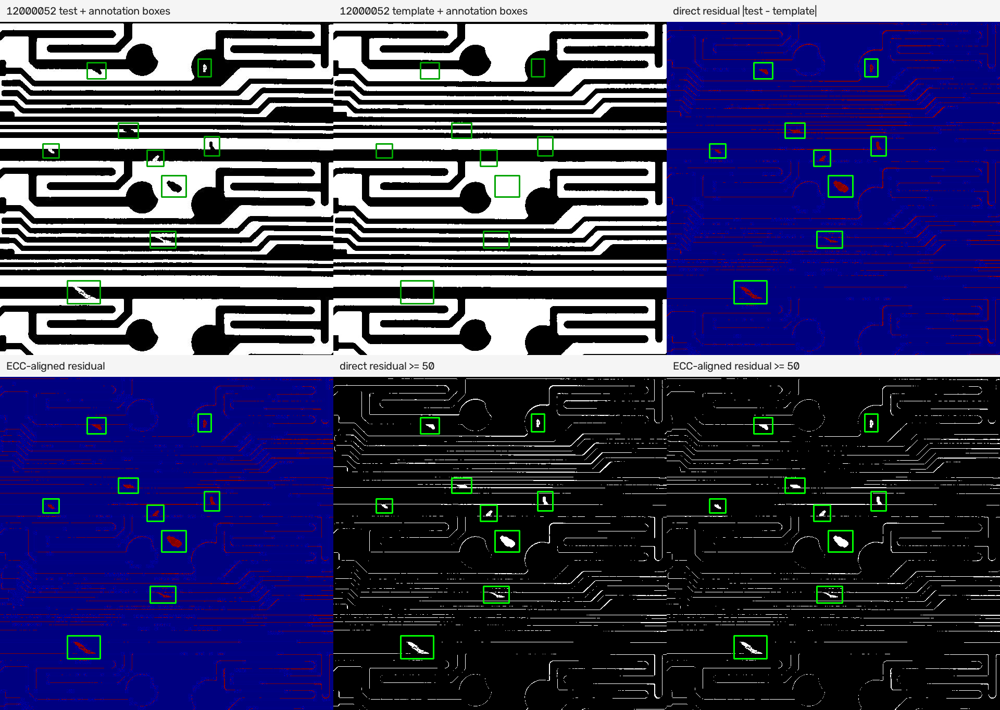
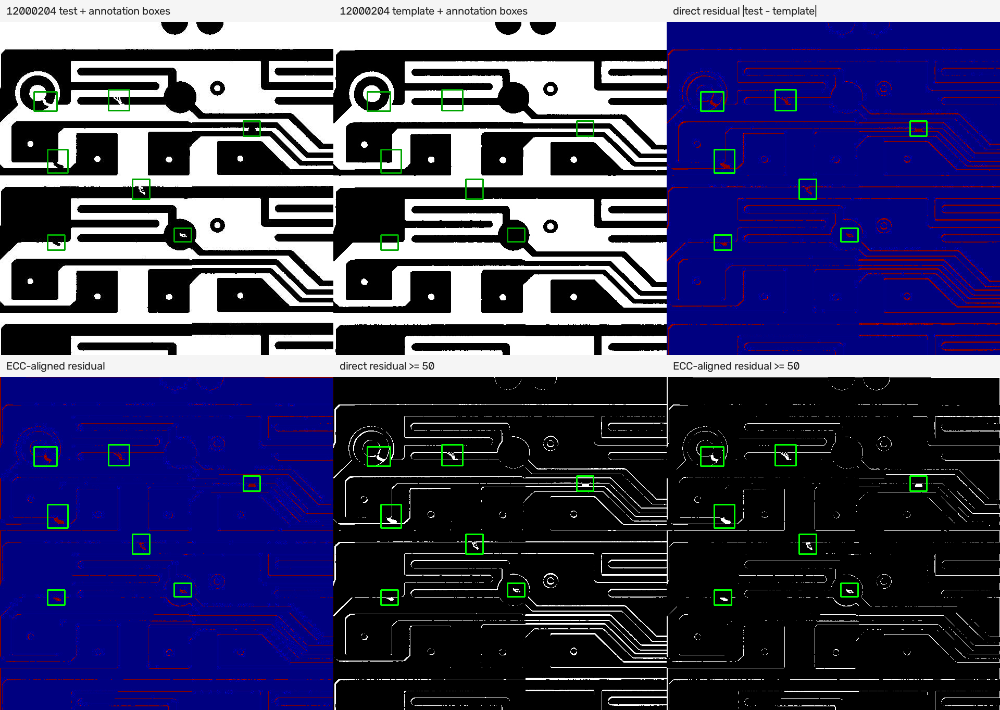

# DeepPCB 数据实况核查

本报告由 `scripts/check_data_reality.py` 生成，解释器为 `python`。
数据根目录为 `data/raw/DeepPCB/PCBData`，固定随机种子为 `20260811`。
报告中的像素统计基于 JPEG 解码后的图像。

## 1. 数据规模

数据规模依据 `data/raw/DeepPCB/PCBData/trainval.txt`、`data/raw/DeepPCB/PCBData/test.txt` 的实际非空行，以及 `PCBData` 下的 JPG 文件名配对结果。
- 列表中的图像对总数：`1500`。`trainval.txt` 实际 `1000` 对，`test.txt` 实际 `500` 对。
- 文件系统中 `_test.jpg` 共 `1500` 张，`_temp.jpg` 共 `1501` 张，按同一数字 ID 匹配得到 `1500` 对。
- 文件系统中存在 `1` 张未配对模板图：`data/raw/DeepPCB/PCBData/group90100/90100/90100034_temp.jpg`。
| 划分文件 | 实际非空行数 | 图像对数 | 占 1500 对 |
| --- | --- | --- | --- |
| trainval.txt | 1000 | 1000 | 66.67% |
| test.txt | 500 | 500 | 33.33% |

目录组织方式为 `PCBData/groupXXXXX/XXXXX/{数字ID}_test.jpg`、`{数字ID}_temp.jpg`，对应标注位于同级的 `XXXXX_not/{数字ID}.txt`。两个列表文件每行记录待检图相对路径和标注相对路径，模板路径由 `_test.jpg` 与 `_temp.jpg` 后缀替换得到。

## 2. 图像属性

属性统计覆盖 `PCBData` 下全部 `3001` 个 JPG 文件，其中包括上面列出的未配对模板图。尺寸、模式、位深和通道数来自 Pillow 解码结果。像素值直方图统一按每个空间像素的灰度值统计，RGB 文件先按 `cv2.COLOR_RGB2GRAY` 转灰度。

### 2.1 尺寸、位深、格式和通道

| 属性 | 实测分布 |
| --- | --- |
| 尺寸 | 640×640：3001 张 |
| Pillow 模式 | L：2939 张；RGB：62 张 |
| 文件格式 | JPEG：3001 张 |
| NumPy dtype | uint8：3001 张 |
| 位深 | 8 bit/通道：3001 张 |
| 通道数 | 1 通道：2939 张；3 通道：62 张 |

RGB 文件共 `62` 张，其中三个通道逐像素完全相同的有 `61` 张。

### 2.2 唯一像素值和二值判定

| 文件角色 | 张数 | 每图唯一灰度值个数分布 | 严格不超过 2 个值 |
| --- | --- | --- | --- |
| test | 1500 | n=1500，最小 44，P5 70，中位数 79，均值 79.90，P95 97，最大 135 | 0 张（0.00%） |
| template | 1501 | n=1501，最小 1，P5 15，中位数 16，均值 16.50，P95 18，最大 35 | 3 张（0.20%） |

全部图像共统计 `1,229,209,600` 个空间像素。严格按解码后的灰度值判定，唯一值不超过 2 个的图像为 `3/3001`（0.10%）。
全体像素中值为 0 或 255 的比例为 `93.99%`，其余灰度值比例为 `6.01%`。因此报告同时保留严格二值判定和极端值像素占比，避免把 JPEG 解码后的近二值现象写成严格二值。

### 2.3 像素值直方图

下表是全部 3001 张 JPG 的灰度像素直方图，计数单位为空间像素。

| 灰度值 | 像素数 | 占全部像素 |
| --- | --- | --- |
| 0 | 393,994,025 | 32.0526% |
| 1 | 10,618,091 | 0.8638% |
| 2 | 6,890,552 | 0.5606% |
| 3 | 4,043,539 | 0.3290% |
| 4 | 3,000,408 | 0.2441% |
| 5 | 1,667,063 | 0.1356% |
| 6 | 1,142,574 | 0.0930% |
| 7 | 1,073,558 | 0.0873% |
| 8 | 845,540 | 0.0688% |
| 9 | 837,522 | 0.0681% |
| 10 | 689,471 | 0.0561% |
| 11 | 739,726 | 0.0602% |
| 12 | 550,032 | 0.0447% |
| 13 | 536,557 | 0.0437% |
| 14 | 560,025 | 0.0456% |
| 15 | 380,616 | 0.0310% |
| 16 | 361,402 | 0.0294% |
| 17 | 286,827 | 0.0233% |
| 18 | 255,111 | 0.0208% |
| 19 | 249,606 | 0.0203% |
| 20 | 186,305 | 0.0152% |
| 21 | 159,224 | 0.0130% |
| 22 | 113,064 | 0.0092% |
| 23 | 65,931 | 0.0054% |
| 24 | 56,914 | 0.0046% |
| 25 | 102,446 | 0.0083% |
| 26 | 40,719 | 0.0033% |
| 27 | 30,033 | 0.0024% |
| 28 | 33,758 | 0.0027% |
| 29 | 42,188 | 0.0034% |
| 30 | 19,564 | 0.0016% |
| 31 | 11,796 | 0.0010% |
| 32 | 17,891 | 0.0015% |
| 33 | 8,204 | 0.0007% |
| 34 | 6,869 | 0.0006% |
| 35 | 10,158 | 0.0008% |
| 36 | 4,260 | 0.0003% |
| 37 | 6,064 | 0.0005% |
| 38 | 2,108 | 0.0002% |
| 39 | 7,024 | 0.0006% |
| 40 | 1,284 | 0.0001% |
| 41 | 657 | 0.0001% |
| 42 | 578 | 0.0000% |
| 43 | 493 | 0.0000% |
| 44 | 925 | 0.0001% |
| 45 | 733 | 0.0001% |
| 46 | 1,420 | 0.0001% |
| 47 | 2,054 | 0.0002% |
| 48 | 210 | 0.0000% |
| 49 | 84 | 0.0000% |
| 50 | 24 | 0.0000% |
| 51 | 27 | 0.0000% |
| 52 | 154 | 0.0000% |
| 53 | 175 | 0.0000% |
| 54 | 8 | 0.0000% |
| 55 | 3 | 0.0000% |
| 56 | 168 | 0.0000% |
| 57 | 2 | 0.0000% |
| 58 | 3 | 0.0000% |
| 59 | 6 | 0.0000% |
| 60 | 10 | 0.0000% |
| 61 | 6 | 0.0000% |
| 62 | 3 | 0.0000% |
| 63 | 4 | 0.0000% |
| 64 | 2 | 0.0000% |
| 65 | 2 | 0.0000% |
| 66 | 2 | 0.0000% |
| 67 | 1 | 0.0000% |
| 69 | 5 | 0.0000% |
| 70 | 4 | 0.0000% |
| 71 | 6 | 0.0000% |
| 72 | 1 | 0.0000% |
| 73 | 1 | 0.0000% |
| 74 | 2 | 0.0000% |
| 75 | 3 | 0.0000% |
| 86 | 2 | 0.0000% |
| 88 | 4 | 0.0000% |
| 90 | 1 | 0.0000% |
| 91 | 1 | 0.0000% |
| 92 | 1 | 0.0000% |
| 93 | 1 | 0.0000% |
| 95 | 2 | 0.0000% |
| 96 | 1 | 0.0000% |
| 97 | 1 | 0.0000% |
| 98 | 1 | 0.0000% |
| 102 | 2 | 0.0000% |
| 103 | 1 | 0.0000% |
| 104 | 1 | 0.0000% |
| 106 | 4 | 0.0000% |
| 107 | 2 | 0.0000% |
| 111 | 2 | 0.0000% |
| 112 | 1 | 0.0000% |
| 113 | 1 | 0.0000% |
| 114 | 1 | 0.0000% |
| 115 | 1 | 0.0000% |
| 116 | 1 | 0.0000% |
| 119 | 2 | 0.0000% |
| 120 | 2 | 0.0000% |
| 122 | 1 | 0.0000% |
| 123 | 4 | 0.0000% |
| 124 | 5 | 0.0000% |
| 125 | 6 | 0.0000% |
| 126 | 13 | 0.0000% |
| 127 | 32 | 0.0000% |
| 128 | 5 | 0.0000% |
| 129 | 5 | 0.0000% |
| 130 | 3 | 0.0000% |
| 131 | 3 | 0.0000% |
| 132 | 1 | 0.0000% |
| 134 | 1 | 0.0000% |
| 135 | 1 | 0.0000% |
| 137 | 1 | 0.0000% |
| 138 | 1 | 0.0000% |
| 139 | 1 | 0.0000% |
| 141 | 1 | 0.0000% |
| 142 | 2 | 0.0000% |
| 144 | 5 | 0.0000% |
| 145 | 10 | 0.0000% |
| 146 | 38 | 0.0000% |
| 147 | 128 | 0.0000% |
| 148 | 203 | 0.0000% |
| 149 | 370 | 0.0000% |
| 150 | 2,242 | 0.0002% |
| 151 | 702 | 0.0001% |
| 152 | 218 | 0.0000% |
| 153 | 112 | 0.0000% |
| 154 | 46 | 0.0000% |
| 155 | 13 | 0.0000% |
| 156 | 1 | 0.0000% |
| 157 | 1 | 0.0000% |
| 158 | 1 | 0.0000% |
| 161 | 1 | 0.0000% |
| 162 | 2 | 0.0000% |
| 164 | 1 | 0.0000% |
| 167 | 1 | 0.0000% |
| 171 | 1 | 0.0000% |
| 173 | 1 | 0.0000% |
| 176 | 2 | 0.0000% |
| 177 | 1 | 0.0000% |
| 178 | 1 | 0.0000% |
| 181 | 1 | 0.0000% |
| 182 | 2 | 0.0000% |
| 185 | 2 | 0.0000% |
| 189 | 1 | 0.0000% |
| 190 | 1 | 0.0000% |
| 191 | 2 | 0.0000% |
| 192 | 4 | 0.0000% |
| 194 | 6 | 0.0000% |
| 195 | 8 | 0.0000% |
| 196 | 3 | 0.0000% |
| 197 | 4 | 0.0000% |
| 198 | 1 | 0.0000% |
| 199 | 137 | 0.0000% |
| 200 | 6 | 0.0000% |
| 201 | 5 | 0.0000% |
| 202 | 192 | 0.0000% |
| 203 | 172 | 0.0000% |
| 204 | 37 | 0.0000% |
| 205 | 48 | 0.0000% |
| 206 | 105 | 0.0000% |
| 207 | 262 | 0.0000% |
| 208 | 2,048 | 0.0002% |
| 209 | 1,318 | 0.0001% |
| 210 | 860 | 0.0001% |
| 211 | 1,125 | 0.0001% |
| 212 | 435 | 0.0000% |
| 213 | 623 | 0.0001% |
| 214 | 671 | 0.0001% |
| 215 | 1,025 | 0.0001% |
| 216 | 7,273 | 0.0006% |
| 217 | 2,053 | 0.0002% |
| 218 | 6,184 | 0.0005% |
| 219 | 4,413 | 0.0004% |
| 220 | 9,302 | 0.0008% |
| 221 | 6,446 | 0.0005% |
| 222 | 8,505 | 0.0007% |
| 223 | 17,205 | 0.0014% |
| 224 | 11,781 | 0.0010% |
| 225 | 21,812 | 0.0018% |
| 226 | 42,309 | 0.0034% |
| 227 | 34,451 | 0.0028% |
| 228 | 28,807 | 0.0023% |
| 229 | 43,415 | 0.0035% |
| 230 | 111,126 | 0.0090% |
| 231 | 61,214 | 0.0050% |
| 232 | 69,330 | 0.0056% |
| 233 | 112,874 | 0.0092% |
| 234 | 175,556 | 0.0143% |
| 235 | 205,181 | 0.0167% |
| 236 | 264,934 | 0.0216% |
| 237 | 273,538 | 0.0223% |
| 238 | 306,746 | 0.0250% |
| 239 | 391,552 | 0.0319% |
| 240 | 401,117 | 0.0326% |
| 241 | 592,985 | 0.0482% |
| 242 | 558,685 | 0.0455% |
| 243 | 569,729 | 0.0463% |
| 244 | 791,730 | 0.0644% |
| 245 | 724,369 | 0.0589% |
| 246 | 881,338 | 0.0717% |
| 247 | 884,304 | 0.0719% |
| 248 | 1,139,445 | 0.0927% |
| 249 | 1,224,463 | 0.0996% |
| 250 | 1,765,549 | 0.1436% |
| 251 | 3,024,526 | 0.2461% |
| 252 | 4,292,029 | 0.3492% |
| 253 | 7,382,491 | 0.6006% |
| 254 | 11,729,228 | 0.9542% |
| 255 | 761,362,453 | 61.9392% |

## 3. 配准状态

样本来自 `test.txt` 的 `500` 对，使用固定种子 `20260811` 不放回随机抽取 `50` 对。直接残差是待检图与同 ID 模板图的灰度绝对差，ECC 调用为 `cv2.findTransformECC(template, test, MOTION_AFFINE)`，下表中的仿射矩阵把 test 坐标映射到 template 坐标。平移量单位为像素，旋转角由仿射矩阵左上 2×2 部分按 `atan2(m21, m11)` 换算为度。

### 3.1 50 对样本的直接绝对差分汇总

50 对全部像素合并后，绝对差均值为 `5.05`，绝对差 P95 为 `5`，非零像素占比为 `11.77%`。
按每对图像分别计算后，绝对差均值分布为：n=50，最小 0.88，P5 1.70，中位数 3.37，均值 5.05，P95 11.54，最大 16.96。绝对差 P95 分布为：n=50，最小 0，P5 0，中位数 3.50，均值 14.60，P95 18.10，最大 253。非零像素占比分布为：n=50，最小 0.02，P5 0.03，中位数 0.10，均值 0.12，P95 0.26，最大 0.30。

### 3.2 ECC 和仿射参数分布

| 量 | 50 对样本分布 |
| --- | --- |
| ECC 相关系数 | n=50，最小 0.96，P5 0.97，中位数 0.99，均值 0.99，P95 1.00，最大 1.00 |
| tx（有符号） | n=50，最小 -3.20，P5 -1.96，中位数 0.22，均值 0.13，P95 1.76，最大 8.62 |
| ty（有符号） | n=50，最小 -1.91，P5 -1.08，中位数 0.03，均值 0.06，P95 1.54，最大 2.15 |
| 旋转角（有符号，度） | n=50，最小 -0.55，P5 -0.21，中位数 -0.00，均值 -0.03，P95 0.09，最大 1.05 |
| |tx| | n=50，最小 0.02，P5 0.12，中位数 0.72，均值 1.08，P95 2.77，最大 8.62 |
| |ty| | n=50，最小 0.03，P5 0.10，中位数 0.56，均值 0.66，P95 1.63，最大 2.15 |
| |旋转角| | n=50，最小 0.00，P5 0.01，中位数 0.06，均值 0.11，P95 0.25，最大 1.05 |

近零变换统计标准固定为 `|tx|≤1 px`、`|ty|≤1 px`、`|旋转角|≤0.1°`。满足三项的样本为 `21/50`（42.00%），ECC P5 为 `0.96853`。
近似预配准判定口径固定为 `ECC P5≥0.95`、`|tx| P95≤3 px`、`|ty| P95≤2 px`、`|旋转角| P95≤0.3°`。本样本的对应实测值为 `0.96853`、`2.77` px、`1.63` px、`0.25°`。
配准判定：**是，主数据近似预配准，但不是像素级完全对齐**。判定依据是上述 50 对 test/template 文件的 ECC 相关系数和仿射变换，不是 README 的文字描述。直接绝对差仍有非零残差，数值见本节 3.1。

### 3.3 逐样本结果

| 样本 ID | 绝对差均值 | 绝对差 P95 | 非零占比 | ECC | tx | ty | 角度° |
| --- | --- | --- | --- | --- | --- | --- | --- |
| 12300130 | 7.02 | 11 | 20.43% | 0.98609 | 0.06 | -0.71 | 0.0253 |
| 12100024 | 2.91 | 3 | 10.69% | 0.99491 | -0.02 | 0.15 | 0.0285 |
| 90100050 | 6.28 | 6 | 12.86% | 0.98551 | -1.10 | 1.26 | -0.1860 |
| 12100130 | 2.69 | 3 | 8.85% | 0.99479 | -0.67 | -0.45 | 0.0577 |
| 12100156 | 1.63 | 0 | 4.52% | 0.99444 | 0.77 | 0.22 | 0.0220 |
| 12000052 | 13.56 | 236 | 26.89% | 0.97384 | 0.98 | -1.12 | 0.0282 |
| 20085304 | 4.14 | 4 | 9.35% | 0.99293 | 0.51 | -0.68 | 0.0855 |
| 12300151 | 6.86 | 8 | 14.34% | 0.98225 | -1.20 | -0.29 | -0.0185 |
| 12000204 | 16.96 | 253 | 21.19% | 0.98455 | -1.94 | -0.39 | -0.1245 |
| 12100055 | 2.81 | 2 | 9.51% | 0.98609 | 0.33 | -1.03 | 0.0363 |
| 90100044 | 12.01 | 19 | 25.61% | 0.97895 | -3.03 | 1.09 | -0.1765 |
| 12300228 | 10.11 | 13 | 17.10% | 0.96553 | 0.40 | -0.11 | -0.1394 |
| 90100033 | 6.12 | 5 | 11.92% | 0.98290 | -0.69 | 2.15 | -0.2572 |
| 50600058 | 5.26 | 3 | 10.84% | 0.98880 | -0.68 | 0.78 | -0.1921 |
| 00041215 | 2.30 | 1 | 5.56% | 0.99483 | -0.34 | 1.56 | 0.0160 |
| 12300114 | 10.94 | 17 | 30.38% | 0.97671 | 0.70 | 0.20 | -0.0661 |
| 12100178 | 2.38 | 2 | 6.11% | 0.99086 | 0.72 | 0.82 | -0.1466 |
| 12100021 | 7.93 | 14 | 29.90% | 0.98928 | 0.82 | -0.20 | 0.0364 |
| 12100052 | 1.92 | 1 | 5.70% | 0.99386 | 1.20 | -0.71 | -0.0206 |
| 12100016 | 3.60 | 4 | 12.26% | 0.98302 | 0.42 | -0.58 | 0.0489 |
| 12100158 | 4.97 | 7 | 14.85% | 0.99294 | 1.90 | -0.21 | 0.0307 |
| 90100043 | 10.77 | 16 | 25.17% | 0.97548 | -1.59 | 0.77 | -0.1445 |
| 90100003 | 2.35 | 0 | 2.35% | 0.95628 | -1.84 | 1.52 | -0.2317 |
| 20085310 | 5.44 | 7 | 14.82% | 0.98818 | 0.98 | -0.67 | 0.0954 |
| 12100064 | 2.27 | 1 | 6.09% | 0.98936 | 1.08 | 0.10 | 0.0134 |
| 12300237 | 8.63 | 11 | 19.23% | 0.98017 | 1.21 | 0.52 | -0.0466 |
| 90100073 | 4.03 | 2 | 7.06% | 0.97618 | -0.50 | 0.39 | -0.1940 |
| 44000025 | 3.37 | 6 | 13.73% | 0.99413 | 0.62 | 0.14 | 0.0110 |
| 20085319 | 0.88 | 0 | 2.55% | 0.99750 | 0.72 | -0.26 | 0.0769 |
| 00041202 | 2.92 | 0 | 4.90% | 0.99265 | -1.36 | -1.91 | 0.0651 |
| 20085323 | 1.31 | 0 | 4.49% | 0.98057 | 0.36 | -0.52 | 0.0684 |
| 12300069 | 2.37 | 0 | 4.73% | 0.98743 | -0.27 | -0.30 | 0.0479 |
| 44000058 | 3.36 | 4 | 11.99% | 0.99437 | -0.51 | 0.54 | -0.0267 |
| 44000018 | 2.33 | 1 | 5.80% | 0.99598 | -0.30 | -0.85 | -0.0038 |
| 12300248 | 9.70 | 12 | 15.21% | 0.96999 | 1.34 | -0.75 | -0.0920 |
| 90100053 | 6.28 | 6 | 13.58% | 0.98873 | -0.17 | 0.75 | -0.1640 |
| 20085307 | 2.26 | 2 | 7.95% | 0.98784 | 2.45 | -0.35 | 0.1028 |
| 44000034 | 3.28 | 5 | 12.08% | 0.99119 | 0.15 | 0.08 | 0.0217 |
| 44000026 | 2.24 | 2 | 7.99% | 0.99442 | 0.37 | 0.20 | 0.0136 |
| 12100176 | 2.18 | 2 | 6.42% | 0.99521 | 1.06 | 0.18 | -0.0418 |
| 90100074 | 6.87 | 6 | 14.40% | 0.97311 | -1.97 | 0.32 | -0.1903 |
| 90100025 | 6.28 | 4 | 8.70% | 0.99122 | -3.20 | 1.58 | -0.5511 |
| 00041218 | 1.82 | 0 | 3.98% | 0.99214 | -0.36 | -0.13 | -0.0591 |
| 44000051 | 2.31 | 2 | 7.54% | 0.99683 | -0.96 | 1.42 | -0.1705 |
| 13000201 | 2.22 | 0 | 2.13% | 0.98911 | 8.62 | -1.67 | 1.0504 |
| 12300077 | 3.33 | 1 | 5.43% | 0.99117 | 1.59 | -0.69 | 0.0652 |
| 77000101 | 1.78 | 0 | 3.80% | 0.99339 | -1.12 | 0.45 | -0.0829 |
| 12300227 | 10.96 | 17 | 17.58% | 0.96733 | 0.29 | 0.83 | -0.0321 |
| 12100195 | 2.94 | 3 | 9.45% | 0.99233 | 0.10 | -0.62 | -0.0049 |
| 12100058 | 5.69 | 8 | 20.46% | 0.98994 | 0.71 | -0.03 | 0.0350 |

## 4. 标注

标注统计依据 `PCBData/group*/ *_not/*.txt` 的实际内容，共 1500 个与图像对对应的标注文件；类别名称同时对照 `data/raw/DeepPCB/README.md` 的映射。
实际格式是每行 `[(5, 10013)]` 个空白分隔字段，分隔符统计为 `{'逗号分隔': 0, '空白分隔': 10013}`。每行字段顺序为 `x1 y1 x2 y2 type`，不是 README 示例中写的逗号分隔形式。

### 4.1 类别 ID 映射

| 原始 class ID | 实际名称 |
| --- | --- |
| 0 | background（未使用） |
| 1 | open |
| 2 | short |
| 3 | mousebite |
| 4 | spur |
| 5 | copper（项目语义：spurious copper） |
| 6 | pin-hole |

### 4.2 每图缺陷数

| 划分 | 图像数 | 每图标注框数分布 |
| --- | --- | --- |
| trainval | 1000 | n=1000，最小 1，P5 4，中位数 7，均值 6.87，P95 10，最大 15 |
| test | 500 | n=500，最小 2，P5 4，中位数 6，均值 6.28，P95 9，最大 13 |
| all | 1500 | n=1500，最小 1，P5 4，中位数 7，均值 6.68，P95 10，最大 15 |

全部图像的每图缺陷数频数：

| 每图框数 | 图像数 | 占全部图像 |
| --- | --- | --- |
| 1 | 4 | 0.27% |
| 2 | 7 | 0.47% |
| 3 | 25 | 1.67% |
| 4 | 103 | 6.87% |
| 5 | 260 | 17.33% |
| 6 | 335 | 22.33% |
| 7 | 310 | 20.67% |
| 8 | 216 | 14.40% |
| 9 | 152 | 10.13% |
| 10 | 60 | 4.00% |
| 11 | 10 | 0.67% |
| 12 | 14 | 0.93% |
| 13 | 3 | 0.20% |
| 15 | 1 | 0.07% |

### 4.3 缺陷框宽、高和面积

全部 `10013` 个标注框的宽度分布为：n=10013，最小 18，P5 27，中位数 35，均值 38.93，P95 64，最大 173。高度分布为：n=10013，最小 19，P5 25，中位数 33，均值 35.67，P95 56，最大 152。面积分布为：n=10013，最小 400，P5 756，中位数 1,184，均值 1,425.64，P95 2,953.20，最大 16,750。宽度和高度均按 `x2-x1`、`y2-y1` 计算，面积为宽乘高。

| ID | 类别 | 框数 | 含该类图像数 | 宽度分布 | 高度分布 | 面积分布 |
| --- | --- | --- | --- | --- | --- | --- |
| 1 | open | 1942 | 1344 | n=1942，最小 22，P5 29，中位数 38，均值 44.74，P95 84，最大 167 | n=1942，最小 19，P5 26，中位数 34，均值 38.43，P95 63，最大 151 | n=1942，最小 500，P5 858，中位数 1,320，均值 1,803.14，P95 4,234.90，最大 16,750 |
| 2 | short | 1506 | 1101 | n=1506，最小 21，P5 26，中位数 41，均值 45.31，P95 86.75，最大 173 | n=1506，最小 20，P5 25，中位数 36，均值 40.15，P95 68，最大 152 | n=1506，最小 693，P5 938.25，中位数 1,486.50，均值 1,775.29，P95 3,654.75，最大 15,000 |
| 3 | mousebite | 1965 | 1269 | n=1965，最小 20，P5 26，中位数 34，均值 35.53，P95 50，最大 106 | n=1965，最小 20，P5 25，中位数 30，均值 31.48，P95 44，最大 81 | n=1965，最小 400，P5 700，中位数 1,024，均值 1,138.63，P95 1,900，最大 8,268 |
| 4 | spur | 1625 | 1184 | n=1625，最小 24，P5 28，中位数 34，均值 35.06，P95 46，最大 107 | n=1625，最小 21，P5 26，中位数 32，均值 33.15，P95 46，最大 140 | n=1625，最小 546，P5 800，中位数 1,080，均值 1,172.59，P95 1,926.60，最大 5,460 |
| 5 | copper（项目语义：spurious copper） | 1474 | 1241 | n=1474，最小 18，P5 28，中位数 36，均值 37.70，P95 54，最大 101 | n=1474，最小 22，P5 27，中位数 36，均值 37.53，P95 53，最大 142 | n=1474，最小 528，P5 783.65，中位数 1,292，均值 1,451.29，P95 2,600，最大 6,390 |
| 6 | pin-hole | 1501 | 1315 | n=1501，最小 21，P5 26，中位数 33，均值 34.86，P95 49，最大 138 | n=1501，最小 20，P5 25，中位数 32，均值 34.01，P95 49，最大 106 | n=1501，最小 483，P5 702，中位数 1,085，均值 1,210.92，P95 2,050，最大 14,628 |

最小缺陷尺寸记录如下。坐标来自对应标注文件，尺寸来自该框本身。

| 指标 | 图像 ID | 划分 | 类别 | 标注文件 | 坐标 | 尺寸 |
| --- | --- | --- | --- | --- | --- | --- |
| 最小面积框 | 20085019 | trainval | mousebite | group20085/20085_not/20085019.txt | (525,450,545,470) | 20×20，面积 400 |
| 最小宽度框 | 44000026 | test | copper（项目语义：spurious copper） | group44000/44000_not/44000026.txt | (621,526,639,561) | 18×35，面积 630 |
| 最小高度框 | 20085012 | trainval | open | group20085/20085_not/20085012.txt | (329,0,356,19) | 27×19，面积 513 |

## 5. 模板分组

模板分组依据图像相对路径中的 `groupXXXXX`、其下一级模板目录 `XXXXX` 以及数字文件名前缀。1500 个列表记录中，三者一致的记录数为 `1500/1500`。
可从目录和文件名还原出 `11` 个模板组。trainval 中出现 `7` 组，test 中出现 `11` 组，两个官方划分交叠 `7` 组。

| 目录组 | 模板 ID | 总对数 | trainval | test |
| --- | --- | --- | --- | --- |
| group00041 | 00041 | 221 | 200 | 21 |
| group12000 | 12000 | 14 | 0 | 14 |
| group12100 | 12100 | 146 | 0 | 146 |
| group12300 | 12300 | 98 | 0 | 98 |
| group13000 | 13000 | 216 | 198 | 18 |
| group20085 | 20085 | 325 | 291 | 34 |
| group44000 | 44000 | 100 | 50 | 50 |
| group50600 | 50600 | 79 | 50 | 29 |
| group77000 | 77000 | 107 | 100 | 7 |
| group90100 | 90100 | 74 | 0 | 74 |
| group92000 | 92000 | 120 | 111 | 9 |

每组图像对数分布为：n=11，最小 14，P5 44，中位数 107，均值 136.36，P95 273，最大 325；最大组与最小组之比为 `23.21`。按这组实测数量差异，模板组分布判定为**不均衡**。
官方 trainval/test 划分的组交叠数为 `7/11`，另有 `4` 组只出现在 test，因此官方划分不是模板隔离划分。上述结论来自 `PCBData` 路径和两个官方列表文件，不是根据图像外观推断。

## 6. 结论及对方法的影响

1. **M1 配准**：M1 配准结论：主数据是近似预配准，不是像素级完全对齐。50 对 test/template 样本中 21/50 对满足更严格的近零变换标准，ECC P5 为 0.96853，|tx| P95 为 2.77 px，|ty| P95 为 1.63 px，|旋转角| P95 为 0.25°；M1 在这批原始主数据上的实测作用是小残余对齐和质量核查，不是从大位移开始的几何配准。（依据：`data/raw/DeepPCB/PCBData/test.txt` 的 500 对中固定种子抽取的 50 对，逐对文件见第 3.3 节。）
2. **M2 外观差异**：M2 外观差异结论：严格二值判定为否，严格二值图比例为 3/3001，值 0 或 255 的像素占比为 93.99%；文件中存在 JPEG 解码灰度值，但像素仍集中在极端值附近，连续光度变化的实测空间有限。（依据：`PCBData` 下全部 3001 个 JPG 的解码像素、唯一值统计和第 2.3 节完整直方图。）
3. **RQ1 消融**：RQ1 判定：保留 A2 到 A3，但将 A3 明确标为近二值 JPEG 图像上的增量检验，单独报告其差异，不能把 A3 的收益解释为普通连续光度纹理带来的收益。（依据：上述全部图像像素统计，而不是依据方案文档中的先验描述。）
4. **最小证据目标**：最小面积框为 `20×20` 像素，面积 `400`，来自图像 `20085019`；最小宽度为 `18` 像素，最小高度为 `19` 像素。这个尺寸记录给出了证据卡局部放大的实测下限。（依据：1500 个标注文件中的全部 10013 个框，第 4.3 节。）
5. **防泄漏分组**：模板 ID 可以从目录和文件名稳定还原，但数量分布不均衡，最大组/最小组为 `23.21`，官方 trainval/test 共享 `7/11` 组，另有 `4` 组只在 test。模板分组前提已被文件结构确认，官方划分的组隔离状态已被排除。（依据：1500 条官方列表记录和 `PCBData/group*/` 实际路径，第 5 节。）

## 7. 补充核查

本节由 `scripts/check_data_followup.py` 生成，像素统计仍基于 JPEG 解码后的灰度图；直接残差和 ECC 沿用第 3 节的定义。高残差区域统计固定使用 `|test-template|≥50`，标注框区域使用对应 `*_not/{数字ID}.txt` 中所有框的并集。

### 7.1 62 张 RGB 图像的分布

62 张 RGB 文件按目录组分布如下；表中 `_test` 和 `_temp` 是文件角色，`trainval`、`test` 是官方列表归属的文件数，`未列入` 表示路径不在两个官方列表对应的 1500 对中。

| 模板组 | RGB 文件数 | _test | _temp | trainval 文件 | test 文件 | 未列入 |
| --- | --- | --- | --- | --- | --- | --- |
| group00041 | 6 | 5 | 1 | 6 | 0 | 0 |
| group12100 | 5 | 3 | 2 | 0 | 5 | 0 |
| group12300 | 1 | 1 | 0 | 0 | 1 | 0 |
| group13000 | 7 | 3 | 4 | 6 | 1 | 0 |
| group20085 | 6 | 6 | 0 | 6 | 0 | 0 |
| group44000 | 14 | 11 | 3 | 7 | 7 | 0 |
| group50600 | 9 | 0 | 9 | 8 | 1 | 0 |
| group77000 | 3 | 1 | 2 | 3 | 0 | 0 |
| group90100 | 10 | 7 | 3 | 0 | 10 | 0 |
| group92000 | 1 | 1 | 0 | 1 | 0 | 0 |

角色计数为：待检图 `_test` `38` 张，模板图 `_temp` `24` 张。官方划分归属为：trainval `37` 张，test `25` 张，未列入官方划分 `0` 张。（依据：`data/raw/DeepPCB/PCBData/trainval.txt`、`test.txt` 及 `experiments/stage0_followup/rgb_files.csv`。）
62 张中有 `61` 张三个通道逐像素完全相同；唯一一张三通道不同的是 `data/raw/DeepPCB/PCBData/group44000/44000/44000020_test.jpg`，其三通道两两绝对差的最大值为 `251`。（依据：上述 RGB 文件的 JPEG 解码像素，逐文件记录见 `experiments/stage0_followup/rgb_files.csv`。）
因此 RGB 文件不是集中于单一模板组，而是分布在 `10` 个模板组；其中未列入官方划分的文件仍属于文件系统中的 RGB 统计，但不属于 trainval/test 的官方样本。逐文件依据见 `experiments/stage0_followup/rgb_files.csv`，分组汇总依据见 `experiments/stage0_followup/rgb_group_summary.csv`；组名和划分来自 `data/raw/DeepPCB/PCBData/group*/`、`trainval.txt`、`test.txt`。

### 7.2 两对异常大残差的对应关系和空间位置

两对均使用同一数字 ID 的 `_test.jpg` 与 `_temp.jpg`，且都位于 `group12000` 的官方 `test` 列表。下表把标注框外的全局结构指标和标注框内的高残差覆盖率放在一起，判断依据不是某一个局部缺陷。

| ID | 框数 | 标注并集面积 | 绝对差均值 | 绝对差 P95 | ECC | ECC 后 P95 | 框外均值 | 框外 P95 | 框外二值结构一致 | 高差像素在框内 |
| --- | --- | --- | --- | --- | --- | --- | --- | --- | --- | --- |
| 12000052 | 9 | 3.15% | 13.56 | 236 | 0.97384 | 15 | 12.96 | 21 | 95.195% | 7.73% |
| 12000204 | 7 | 2.32% | 16.96 | 253 | 0.98455 | 7 | 16.58 | 253 | 93.665% | 4.49% |

大残差区域的坐标和象限分布如下。坐标为 `x1,y1,x2,y2`，右下边界采用半开区间；高差像素是 `|test-template|≥50` 的像素。

| ID | 高差像素包围框 | 高差像素数 | 左上 | 右上 | 左下 | 右下 | 高差落框内 | 框外区域高差占比 |
| --- | --- | --- | --- | --- | --- | --- | --- | --- |
| 12000052 | (0, 3, 640, 640) | 20659 | 27.39% | 32.08% | 18.05% | 22.49% | 7.73% | 4.81% |
| 12000204 | (0, 0, 640, 640) | 26539 | 19.70% | 24.19% | 16.85% | 39.26% | 4.49% | 6.33% |

两对的 test/template 整体结构对比图如下：

图中绿色框为实际标注框，颜色残差图显示高差位置。

判断：两对确实对应同一块板的同一整体结构，不是待检图与模板图错配。依据是两对均为同 ID、同 `group12000` 的文件配对，ECC 分别为 `0.97384` 和 `0.98455`，ECC 对齐后的 P95 已降为 `15` 和 `7`；这说明原始高差可以由小幅几何配准改善，整体板面结构是对应的。依据：`data/raw/DeepPCB/PCBData/group12000/12000/12000052_test.jpg`、`12000052_temp.jpg`、`12000204_test.jpg`、`12000204_temp.jpg` 及 `experiments/stage0_followup/group12000_metrics.csv`。
区域判断：`12000052` 的直接高差包围框为 `(0, 3, 640, 640)`，`12000204` 为 `(0, 0, 640, 640)`，两者均覆盖几乎整幅图；高差像素落在标注框内的比例只有 `7.73%` 和 `4.49%`，也就是落在框外的比例分别为 `92.27%` 和 `95.51%`；框外区域自身的高差像素占比分别为 `4.81%` 和 `6.33%`。因此大残差不是主要集中在标注框内，不能解释为缺陷面积单独造成，主要表现为整幅板线/边缘的原始几何差异。依据：上述四张图像、两个标注文件和 `experiments/stage0_followup/12000052_structure_residual.png`、`experiments/stage0_followup/12000204_structure_residual.png`。

### 7.3 group12000 全部 14 对

`group12000` 的 14 对全部来自官方 `test.txt`；逐对绝对差和 ECC 结果如下。高差像素在标注框内的比例仍使用 `|Δ|≥50`。（依据：`data/raw/DeepPCB/PCBData/test.txt`、`group12000/12000/*.jpg`、`group12000/12000_not/*.txt`。）

| ID | 框数 | 标注并集面积 | 绝对差均值 | 绝对差 P95 | ECC 后 P95 | 高差≥50 | 高差框内 | ECC | tx | ty |
| --- | --- | --- | --- | --- | --- | --- | --- | --- | --- | --- |
| 12000001 | 9 | 2.34% | 5.88 | 5 | 4 | 2.13% | 10.46% | 0.99043 | 0.42 | 0.19 |
| 12000017 | 7 | 2.87% | 30.70 | 255 | 6 | 11.88% | 4.12% | 0.98838 | -0.86 | -3.05 |
| 12000038 | 8 | 2.80% | 7.00 | 9 | 9 | 2.42% | 14.04% | 0.98484 | -0.80 | -0.33 |
| 12000052 | 9 | 3.15% | 13.56 | 236 | 15 | 5.04% | 7.73% | 0.97384 | 0.98 | -1.12 |
| 12000068 | 6 | 1.87% | 22.10 | 254 | 10 | 8.46% | 3.72% | 0.98748 | -0.65 | -2.00 |
| 12000085 | 5 | 1.49% | 9.06 | 9 | 5 | 3.40% | 6.99% | 0.98981 | -0.12 | -1.60 |
| 12000102 | 6 | 2.20% | 14.89 | 251 | 6 | 5.67% | 5.11% | 0.98918 | 2.14 | -1.42 |
| 12000119 | 6 | 1.67% | 33.67 | 255 | 7 | 13.05% | 1.90% | 0.98698 | -1.55 | -2.25 |
| 12000136 | 6 | 1.79% | 39.81 | 255 | 11 | 15.44% | 2.63% | 0.98433 | -0.28 | -2.71 |
| 12000155 | 7 | 2.39% | 17.27 | 254 | 251 | 6.50% | 5.24% | 0.96458 | 0.31 | -0.82 |
| 12000171 | 6 | 1.59% | 15.56 | 252 | 248 | 5.92% | 2.74% | 0.97039 | 3.96 | -0.98 |
| 12000187 | 6 | 2.29% | 8.41 | 8 | 5 | 3.17% | 9.96% | 0.98570 | -1.90 | -1.67 |
| 12000204 | 7 | 2.32% | 16.96 | 253 | 7 | 6.48% | 4.49% | 0.98455 | -1.94 | -0.39 |
| 12000593 | 5 | 1.63% | 5.41 | 6 | 6 | 1.88% | 9.30% | 0.99032 | 1.27 | 0.31 |

全组原始绝对差 P95 的分布为：n=14，最小 5，P5 5.65，中位数 251.50，均值 164.43，P95 255，最大 255；ECC 的分布为：n=14，最小 0.96，P5 0.97，中位数 0.99，均值 0.98，P95 0.99，最大 0.99；ECC 对齐后 P95 的分布为：n=14，最小 4，P5 4.65，中位数 7，均值 42.14，P95 249.05，最大 251。14 对中有 `9` 对原始绝对差 P95 达到或超过 20，ECC 对齐后仍有 `2` 对达到或超过 20，所以这不是 50 对样本中仅 `12000052`、`12000204` 两对的个别现象，而是 group12000 的组级原始配准异常，虽不是每一对都异常。依据：`experiments/stage0_followup/group12000_metrics.csv` 和 `data/raw/DeepPCB/PCBData/group12000/12000/*.jpg`。
标注并集面积占比为：n=14，最小 1.49%，P5 1.55%，中位数 2.24%，均值 2.17%，P95 2.97%，最大 3.15%；14 对直接高差像素落在标注框内的比例为：n=14，最小 1.90%，P5 2.38%，中位数 5.17%，均值 6.32%，P95 11.71%，最大 14.04%。`12000052` 的标注并集面积占比为 `3.15%`，是全组最大；但 `12000204` 只有 `2.32%`，接近全组中位数，且 `12000119`、`12000136` 也分别以 `1.67%`、`1.79%` 的较小标注面积出现 P95 为 255。因此原始 P95 高低不能归因于缺陷面积大小。依据：`group12000/12000_not/*.txt` 和 `experiments/stage0_followup/group12000_metrics.csv`。
与其余官方 test 对比：group12000 的 `14` 对直接绝对差均值为 `17.16`，逐对 P95 中位数为 `251.50`，P95≥20 有 `9/14`；其余 `486` 对对应为均值 `5.75`，P95 中位数 `3`，P95≥20 有 `46/486`。依据：`data/raw/DeepPCB/PCBData/test.txt`、`experiments/stage0_followup/test_direct_metrics.csv` 和 `group12000_metrics.csv`。

### 7.4 明确判断

**明确判断：`group12000` 是数据质量问题，不是单纯缺陷面积特别大；按当前实验的原始 test/template 残差口径，应从实验样本中剔除全部 14 对，并在论文中说明。** 这里的“数据问题”不是两张图来自不同板，而是该组存在组级原始预配准/几何一致性异常：整体结构仍可通过 ECC 对应，但直接高差在整幅板线和边缘上出现，且 group12000 的 P95 分布显著偏离其余 test 对。依据：`data/raw/DeepPCB/PCBData/group12000/12000/*.jpg`、`group12000/12000_not/*.txt`、`data/raw/DeepPCB/PCBData/test.txt` 以及 `experiments/stage0_followup/group12000_metrics.csv`、`experiments/stage0_followup/test_direct_metrics.csv`、`experiments/stage0_followup/12000052_structure_residual.png`、`experiments/stage0_followup/12000204_structure_residual.png`。

论文说明建议：group12000 的 14 对保留在数据实况核查中，但不进入主实验；原因是 14 对中 9 对原始绝对差 P95≥20，组内中位数为 251.5，而其余 test 对中位数为 3.0。ECC 可以把其中多数对齐到较低 P95，但这属于事后补偿，不能把原始组级异常改写成大面积缺陷效应。（依据：`experiments/stage0_followup/group12000_metrics.csv`、`test_direct_metrics.csv` 以及对应 JPG 和标注 TXT。）
